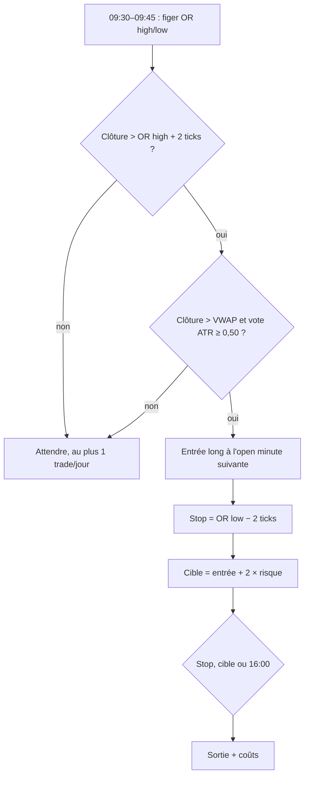

# Fiche signal 01/09 — MNQ ORB + VWAP + ATR

## 1. Carte d'identité

| Champ | Valeur gelée |
|---|---|
| Instrument | Micro E-mini Nasdaq-100 (`MNQ`) |
| Identifiant | `mnq_orb_vwap_atr` |
| Idée | acheter une cassure haussière du range formé pendant les 15 premières minutes de l'ouverture |
| Direction | long uniquement |
| Données | OHLCV 1 minute, session New York |
| Décision / exécution | clôture de la barre de cassure / open minute suivante |
| Risque | 0,50 % d'un capital de référence de 50 000 USD dans le backtest |
| Sortie | stop OR−2 ticks, cible 2R, ou 16:00 ET |

## 2. Intuition économique

Les quinze premières minutes concentrent la découverte de prix et les ordres accumulés avant l'ouverture. Le plus haut et le plus bas de cette fenêtre forment l'**opening range** (`OR`). Une clôture au-dessus de `OR_high` indique que la demande a absorbé l'offre initiale ; la stratégie cherche la continuation de ce mouvement, jamais une anticipation pendant la construction de l'OR.

La **VWAP** (*Volume-Weighted Average Price*) est le prix moyen de la séance pondéré par les volumes : un prix traité au-dessus signifie que l'acheteur entrant est du même côté que la majorité des volumes déjà échangés. Cette confirmation évite d'acheter une cassure qui repasse immédiatement sous le prix d'équilibre intrajournalier.

L'**ATR** (*Average True Range*) mesure l'amplitude récente en points. C'est bien une mesure de volatilité, mais différente de la volatilité statistique des rendements : elle ne calcule pas un écart-type et n'est pas annualisée. Elle mesure une amplitude absolue, sans direction, et prend aussi en compte les gaps entre deux séances.

Pour chaque séance `t`, on calcule d'abord le *True Range* :

`TR_t = max(H_t − L_t, |H_t − C_{t−1}|, |L_t − C_{t−1}|)`

Puis l'ATR Wilder est calculé en parallèle sur 14, 16 et 18 séances. Par exemple : `ATR14_t = (13 × ATR14_{t−1} + TR_t) / 14`, après une initialisation par la moyenne des 14 premiers `TR`. Les deux autres périodes suivent la même formule avec leurs longueurs respectives. Un ATR de 180 signifie donc que l'amplitude récente typique du MNQ est d'environ 180 points ; cela ne prédit pas le sens du prochain mouvement.

Le filtre ne repose pas sur un seuil arbitraire en points. Pour chacune des trois périodes ATR, on classe les valeurs observées sur les **candidats de signal de la période IS uniquement**. Le quantile 20 est la valeur sous laquelle se trouvent 20 % des ATR observés ; le quantile 80 est celle sous laquelle se trouvent 80 % des ATR. Le couple `20/80` accepte donc un candidat si son ATR se situe entre ces deux bornes : il écarte approximativement les 20 % de régimes les plus calmes et les 20 % les plus agités. Le produit cartésien `ATR {14,16,18} × quantile bas {20,25,30} × quantile haut {80,85}` donne 18 avis binaires. Le `vote ATR` est leur moyenne ; `0,50` exige au moins neuf avis favorables sur dix-huit. Les 18 seuils sont estimés sur IS puis figés pour la période suivante.

### Lecture visuelle des indicateurs


La zone bleue représente l'opening range encore en construction ; elle n'est tradable qu'une fois figée. La VWAP orange évolue avec chaque transaction de la séance. Le point de cassure n'est valide que si la clôture dépasse le range, reste au-dessus de la VWAP et reçoit assez de votes du filtre ATR.


Le panneau de gauche montre pourquoi l'ATR tient compte des gaps ; celui de droite montre que l'ATR lisse des amplitudes successives. Une hausse de l'ATR signifie des mouvements plus larges, pas une prévision de hausse du marché.

## 3. Données et horloge

- Construire l'opening range (`OR`) avec les barres `[09:30, 09:45)` : `OR_high=max(high)` et `OR_low=min(low)`.
- Calculer la VWAP continue depuis le début de la séance : `cumsum(prix_typique × volume) / cumsum(volume)`, avec `prix_typique=(high+low+close)/3`.
- Calculer les ATR(14), ATR(16) et ATR(18) avec uniquement les séances terminées. Pour chaque période, comparer sa valeur aux six intervalles IS `(20,25,30) × (80,85)` ; un intervalle vote `1` si l'ATR correspondant est compris entre ses deux bornes, sinon `0`.
- Une clôture de barre n'est connue qu'à la fin de la minute ; aucun fill n'est autorisé à cette même clôture.

## 4. Paramètres et raison du choix

| Paramètre | Valeur | Rôle |
|---|---:|---|
| opening range | 15 min | équilibre entre bruit d'ouverture et retard |
| buffer entrée / stop | 2 / 2 ticks | évite une égalité exacte au bord et laisse une invalidation explicite |
| confirmation VWAP | activée | confirme l'acceptation au-dessus du prix moyen |
| périodes ATR | 14, 16 et 18 | trois horizons voisins pour réduire la dépendance à une longueur unique |
| quantiles bas / hauts | 20, 25, 30 / 80, 85 | six bandes par période ATR, calibrées sur IS |
| vote ATR | ≥ 0,50, soit 9/18 | majorité simple de l'ensemble |
| cible | 2R | payoff défini par le risque initial |
| trade/jour | 1 maximum | empêche le re-entry opportuniste |

### Cubes IS/OOS de robustesse des paramètres

Les deux cubes montrent côte à côte les mêmes trois paramètres testés — période ATR, quantile bas et quantile haut — d'abord sur l'IS de construction, puis sur l'historique OOS. Chaque point est une combinaison backtestée ; sa couleur représente le Sharpe annualisé de la période correspondante, sur une échelle commune. Les 18 carrés bleus sont les sous-modèles du vote retenu : `ATR {14,16,18} × {20,25,30} × {80,85}`. Leur valeur importe moins que l'existence d'un voisinage cohérent dans les trois directions ; un point isolé très brillant serait un signal de sur-ajustement. Dans la version HTML, les cubes peuvent être tournés et zoomés, et chaque valeur est accessible au survol.


## 5. Chaîne causale illustrée



## 6. Règles exactes

Le signal existe lorsque la clôture observable franchit le bord supérieur tamponné, reste au-dessus du VWAP continu et satisfait le vote ATR. La quantité entière est `floor(risk_budget / risk_par_contrat)`, avec `risk_budget=250 USD` dans le backtest et le risque par contrat mesuré entre fill et stop, frais inclus selon l'implémentation. Si la quantité calculée est nulle, ne pas trader.

**Exemple numérique.** Supposons `OR_high=20 020`, `OR_low=20 000`, VWAP `20 012` et 12 avis ATR favorables sur 18, soit un vote de `0,67`. Le seuil est `20 020,50` (deux ticks de `0,25`). Une clôture à `20 021`, suivie d'un fill à `20 021,25`, valide le long. Le stop est `19 999,50`, soit `21,75` points de risque ou `43,50 USD` par MNQ avant frais. Avec un budget de `250 USD`, `floor(250/43,50)=5` contrats. La cible 2R est `20 064,75`. Avec seulement 8 avis favorables sur 18 (`0,44`), aucun ordre ne serait envoyé.

## 7. Exécution, coûts et ambiguïtés

Tick MNQ `0,25` point = `0,50 USD`; valeur du point `2 USD`. Coûts de recherche : `1,25 USD` de commission et un tick défavorable par côté. Stop et cible ne sont évalués qu'avant la sortie de 16:00. Si stop et cible coexistent dans une minute, prendre le stop. Pas de position overnight.

### 7.1 Exécution agrégée par instrument (depuis le 13 novembre 2026)

Cette sleeve n'est plus envoyée seule. Sa position s'additionne à celles des autres sleeves MNQ actives (S01 + S02 + S03) dans **une seule cible nette MNQ**, et seule la différence avec la position du compte est envoyée ([Book, section 7](BOOK.md)). Le signal, la taille, les horaires et le PnL suivi pour la sleeve ne changent pas : la sleeve garde son état virtuel et sa règle d'arrêt.

**Ce qui change pour S01 : son stop et sa cible.** Ils restent posés chez le broker, mais comme ordres stop et limite *indépendants*. Leur quantité est l'effet qu'aurait la sortie de S01 sur la position nette, recalculée chaque minute. Le sizing historique (1 à 4 contrats pour un risque d'environ 250 USD) est conservé.

Exemple de mécanique, 31 janvier 2024. *Note du 15 novembre 2026 : ce trade S01 vient de l'ancien ledger `baseline_fixed`. La sleeve de cette fiche, référence du lock `eight_sleeve_equal_contract_reference_20261115`, ne trade pas ce jour-là. L'exemple reste valable pour la mécanique.* S02 est short depuis 10:37 (vente 1 à 17 294,50). À 14:41, S01 entre long (achat 1 à 17 430,00, stop 17 354,50) : la cible MNQ devient 0 et **le compte est plat**. Le stop de S01 reste pourtant posé, en vente stop de 1 à 17 354,50. À 15:01, il est touché : S01 sort, la cible redevient −1 (le short de S02) et la vente stop exécutée rétablit ce short. Un stop attaché à la position du compte n'aurait pas existé dans ce cas.

## 8. Pseudocode de réimplémentation

```text
pour chaque séance:
  OR = extrêmes des 15 premières minutes
  mettre à jour VWAP et l'état ATR uniquement avec données observables
  si aucun trade et close > OR_high + 2 ticks et close > VWAP et vote_ATR >= 0.50:
      signaler long; entrer à l'open minute suivante
      stop = OR_low - 2 ticks
      target = fill + 2 * (fill - stop)
      quantité = floor(250 / risque_contrat)
  sortir au premier de: stop, target, open 16:00
  débiter slippage et commissions sur chaque côté
```

## 9. Validation historique

> **Données MNQ depuis le 21 novembre 2026.** Ces chiffres sont calculés sur MNQ `v.0` (le contrat le plus échangé, celui que trade la production), ajusté en arrière de l'écart de roll. Ils remplacent ceux calculés sur `c.0`, qui posait trois problèmes :
> - il gardait le contrat qui expire pendant la semaine du roll ;
> - il n'avait aucune barre RTH les vendredis d'échéance ;
> - il créait un faux gap dans l'ATR au changement de contrat.
>
> Règles, paramètres et seuils IS (calibrés sur `c.0`, copiés tels quels) sont inchangés. Sur l'ancienne série `c.0`, la sleeve faisait : historique total 701 trades, `19 416,50 USD`, Sharpe `1,281` ; IS 514 trades, `13 852 USD` ; OOS réutilisé 187 trades, `5 564,50 USD`. Référence : [lock du 21 novembre](../../research/locked_eight_sleeve_portfolio_20261121/locked_eight_sleeve_config.json).

- **IS — 2019-05-05 au 2024-02-27 :** 518 trades, `13 551 USD` nets, Sharpe `1,224`, PF `1,312`, maxDD `−2 142,50 USD`.
- **Historique OOS réutilisé — 2024-02-28 au 2026-03-20 :** 189 trades, `5 065,50 USD`, Sharpe `1,188`, PF `1,342`, maxDD `−891,50 USD`.
- **Historique total — 2019-05-05 au 2026-03-20 :** 707 trades, PnL net `18 616,50 USD`, Sharpe `1,213`, PF `1,319`, maxDD `−2 142,50 USD`.

*Convention de Sharpe (mise à jour le 15 novembre 2026, audit `audit_20261115`, phase 0) : PnL quotidien net en USD, annualisé par √252, jours sans trade inclus, calendrier des séances de semaine de l'instrument. Les valeurs publiées auparavant (1,143 / 1,194 / 1,156) incluaient les dimanches dans le calendrier, ce qui diluait le Sharpe.*


Le découpage temporel est inchangé et les seuils de quantiles restent calibrés exclusivement sur l'IS. En revanche, ce nouvel ensemble ayant été choisi après examen des cubes IS/OOS, la seconde fenêtre est désormais une validation historique réutilisée et non plus un test OOS indépendant.

## 10. Checklist et limites

- Vérifier timezone/DST, sémantique des timestamps, VWAP continu et cutoff 16:00.
- Reproduire exactement 707 trades sur le fichier MNQ `v.0` ajusté (701 sur l'ancien `c.0`) avant toute adaptation.
- Ne pas confondre capital de recherche 50K et sizing du dépôt d'exécution.
- Le 3-state est rejeté pour cette référence ; pas de retuning sur les données vues.

Sources : [résultats sur MNQ v.0](../../research/signal_sheet_01_atr18_v0/summary.json), [résultats sur l'ancien c.0](../../research/signal_sheet_01_atr18/summary.json), [seuils IS](../../research/signal_sheet_01_atr18/thresholds_is.csv), [reconstruction v.0](../../research/mnq_v0_relock_20261121/build_v0_sleeves.py), [implémentation du signal](../../src/strategy/orb.py), [script de reconstruction](../../scripts/rebuild_signal_sheet_01_atr18.py).

## 11. Equity curves FS et OOS


Le panneau **FS** couvre tout l'historique disponible et repère le début de la fenêtre historiquement OOS. Le panneau de droite redémarre à zéro le 28 février 2024 ; cette fenêtre est postérieure au split, mais elle est maintenant qualifiée de réutilisée puisque le nouvel ensemble a été choisi après sa consultation. Le sizing historique à budget de risque et les coûts nominaux sont conservés.

