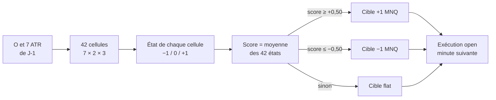

# Fiche signal 02/09 — MNQ volatility breakout

## 1. Carte d'identité

| Champ | Valeur gelée |
|---|---|
| Instrument / ID | MNQ / `mnq_volatility_breakout` |
| Idée | suivre une expansion depuis l'open supérieure à une fraction de l'ATR journalier |
| Direction | long et short symétriques |
| Modèle | ensemble de 42 cellules, vote de positions à `0,50` |
| Signal | niveaux connus après l'open RTH, surveillance 1 minute par cellule |
| Taille exécutée | cible agrégée `−1/0/+1`, soit au plus 1 MNQ |
| Sortie | stop à l'open et time stop par cellule ; vote agrégé ; hard flatten 16:08 |

## 2. Intuition économique

Un déplacement important par rapport à la volatilité récente peut signaler un « trend day ». L'**ATR** (*Average True Range*) mesure une amplitude de prix moyenne, gaps compris. Il est exprimé dans la même unité que le cours : sur MNQ, un ATR de `100` signifie environ `100 points d'indice`, soit `200 USD` par contrat puisque le point vaut `2 USD`. Ce n'est pas une volatilité annualisée en pourcentage et il ne prédit pas la direction. Le seuil s'adapte donc au régime : un mouvement de 60 points est exceptionnel si l'ATR récent vaut 80, mais ordinaire s'il vaut 250.

Chaque cellule place deux niveaux symétriques autour de l'ouverture cash : `U` (*upper*, seuil haut) et `L` (*lower*, seuil bas). Le premier franchi fixe son état long ou short. Il n'y a pas de take-profit : chaque cellule reste active jusqu'au retour à l'open, jusqu'à son time stop de `270`, `300` ou `360` minutes, ou jusqu'au hard flatten. La stratégie exécutée n'empile pas 42 contrats : elle moyenne les 42 états virtuels `−1/0/+1` et ne détient qu'une cible agrégée `−1`, `0` ou `+1 MNQ`.

### Lecture visuelle de l'ATR breakout


Les seuils s'écartent symétriquement de l'open selon l'ATR connu à J−1. Le premier seuil touché fixe le sens ; l'open devient le stop d'invalidation. La figure illustre un long, mais le cas short est strictement symétrique.

## 3. Données et horloge

- `O` est le prix d'ouverture de la session régulière (RTH) à 09:30 ET.
- Pour chaque `n∈{10,12,14,16,18,20,22}`, `ATRn_prev` est le Wilder ATR calculé sur **n journées RTH entières**, jusqu'à J−1 ; il ne s'agit pas de bougies minute.
- Pour chaque multiple `k∈{0,50;0,60}`, `U(n,k)=O+k×ATRn_prev` et `L(n,k)=O−k×ATRn_prev` sont connus dès que l'open est observé.
- Les touches sont ensuite surveillées en 1 minute.

## 4. Paramètres et raison du choix

| Paramètre | Valeur |
|---|---:|
| ATR Wilder | `{10,12,14,16,18,20,22}` séances RTH |
| multiple d'entrée | `{0,50;0,60}` |
| horizon signal | 5 min (état), exécution 1 min |
| durée maximale par cellule | `{270;300;360}` min |
| sous-modèles | `7×2×3 = 42` |
| vote | moyenne des états ; seuil `±0,50`, soit 21 votes nets |
| quantité agrégée | `−1/0/+1 MNQ` |

Le lock n'est plus un point isolé. Il s'agit du produit cartésien **ATR 10 à 22 par pas de 2 × multiple 0,50/0,60 × durée 270/300/360**, soit 42 cellules. Chaque cellule calcule sa position indépendamment. Le score est la moyenne des 42 états : cible longue si `score≥0,50`, courte si `score≤−0,50`, sinon flat. Un changement de cible agrégée est exécuté à l'open de la minute suivante.

### Cubes IS / OOS des trois paramètres

Les deux cubes montrent la grille large — **période ATR** `10–30` par pas de `2`, **multiple d'entrée** `0,20–0,80` par pas de `0,10` et **durée maximale** — soit `770` points par cube. Chaque point est un backtest complet, sans interpolation, et sa couleur représente le Sharpe annualisé sur une échelle commune aux deux périodes. Les **42 carrés bleus** sont les sous-modèles retenus : `ATR {10,12,14,16,18,20,22} × multiple {0,50;0,60} × durée {270;300;360}`. La région importe davantage qu'un maximum ponctuel.


## 5. Chaîne causale illustrée



## 6. Règles exactes

Dans chaque cellule, le premier seuil touché gagne. En gap au-delà du seuil, le prix brut est le pire entre seuil et open minute, puis slippage adverse. Pour un long virtuel, le stop est `O` ; pour un short, le même `O`. Il n'existe **aucun take-profit**. La cellule redevient flat au stop ou à `entry_time+d`, avec `d∈{270,300,360}`. Les positions virtuelles opposées se compensent dans la moyenne. Le seuil exact est inclus : un score de `+0,50` est long et `−0,50` est short.

**Exemple de vote.** Si 24 cellules sont longues, 3 courtes et 15 flat, le score vaut `(24−3)/42=0,50` : la cible agrégée devient `+1 MNQ` à l'open de la minute suivante. Avec 23 longues et 3 courtes, le score vaut `0,476` : la cible reste flat. Les 42 cellules sont donc des avis, pas 42 contrats.

## 7. Exécution, coûts et ambiguïtés

Tick `0,25` = `0,50 USD`; point `2 USD`; commission `1,25 USD/côté`; slippage `1 tick/côté`. Les cellules sont virtuelles : les coûts ne sont débités que lorsque la **cible agrégée** change. Si U et L d'une cellule sont touchés dans la même minute, cette cellule annule son signal. Si entrée et stop sont possibles dans sa minute de fill, chemin conservateur entrée puis stop. Hard flatten agrégé à 16:08 ET, avec calendrier officiel pour les early closes.

## 8. Pseudocode de réimplémentation

```text
cellules = produit(ATR=[10,12,14,16,18,20,22], multiple=[.5,.6], durée=[270,300,360])
pour chaque cellule:
  calculer U/L avec l'ATR Wilder J-1 de sa période
  état = -1, 0 ou +1 selon première touche, stop O et time stop
à chaque changement observable:
  score = moyenne(états des 42 cellules)
  cible = +1 si score>=.50, -1 si score<=-.50, sinon 0
  exécuter le changement de cible à l'open minute suivante
forcer cible=0 au hard flatten
```

## 9. Validation historique

- **Historique total — 2019-05-06 au 2026-03-19 :** 1 085 trades agrégés, `20 259 USD` nets, Sharpe `0,873`, PF `1,239`, maxDD `−4 790,50 USD`.
- **IS — 2019-05-06 au 2023-12-31 :** 726 trades, `10 980 USD` nets, Sharpe `0,831`, PF `1,221`, maxDD `−4 790,50 USD`.
- **OOS / validation réutilisée — 2024-01-01 au 2026-03-19 :** 359 trades, `9 279 USD` nets, Sharpe `0,971`, PF `1,264`, maxDD `−3 714 USD`. La région de 42 cellules ayant été choisie après consultation de ce cube, cette fenêtre n'est plus un OOS prospectif vierge.
- Les couleurs des cubes restent des métriques **par cellule** ; les chiffres ci-dessus proviennent, eux, de la réexécution déterministe du vote agrégé avec coûts sur chaque changement de cible.

## 10. Checklist et limites

- ATR exclusivement J−1 pour les sept périodes ; tester les doubles touches et gaps au-delà du stop.
- Reproduire chaque time stop à la première open minute admissible, puis le vote et son décalage d'exécution d'une minute.
- Ne jamais exécuter 42 contrats : seules les transitions de la cible agrégée `−1/0/+1` sont tradées et facturées.
- Edge corrélé à l'ATR trend MNQ ; ne pas l'interpréter comme un pari indépendant.
- Historique déjà vu : toute modification exige une nouvelle version prospective.

Sources : [résultats exécutés du vote](../../research/signal_sheet_02_cluster/summary.json), [trades agrégés](../../research/signal_sheet_02_cluster/trades.csv), [manifeste gelé des 42 cellules](../../strategy_registry/psf_mnq/frozen_ensembles/volatility_breakout_42.json), [lock MNQ](../../research/locked_four_sleeve_portfolio/locked_four_sleeve_config.json), [spécification gelée](../../strategy_registry/psf_mnq/frozen_baselines/volatility_breakout.json).

## 11. Equity curves FS et OOS/validation


Le panneau **FS** couvre tout l'historique et repère le début de la validation réutilisée au 1er janvier 2024. Le panneau de droite redémarre à zéro sur cette seconde fenêtre. La courbe provient des transitions réellement exécutées par la cible agrégée, pas d'une moyenne des PnL des 42 cellules.

