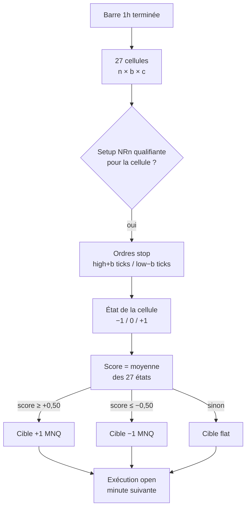

# Fiche signal 03/09 — MNQ compression breakout

## 1. Carte d'identité

| Champ | Valeur gelée |
|---|---|
| Instrument / ID | MNQ / `mnq_compression_breakout` |
| Idée | une inside bar de range minimal prépare une expansion |
| Direction | premier breakout, long ou short |
| Modèle | ensemble de 27 cellules, vote de positions à `0,50` |
| Signal | barres 1 heure RTH par cellule, exécution agrégée 1 minute |
| Taille exécutée | cible agrégée `−1/0/+1`, soit au plus 1 MNQ |
| Sortie | stop opposé et cible par cellule ; vote agrégé ; hard flatten 16:08 |

## 2. Intuition économique

Une **inside bar** est une barre dont le plus haut et le plus bas restent à l'intérieur de la barre précédente. Lorsqu'elle est aussi la plus étroite des `n` dernières barres (`NRn`, *narrowest range over n*), elle matérialise une forte compression : acheteurs et vendeurs sont momentanément en équilibre. La stratégie n'anticipe pas le sens ; elle attend que le prix sorte de cette petite zone et suit le premier camp qui prend le contrôle. La sleeve exécutée moyenne les positions de 27 variantes voisines et ne détient qu'une cible agrégée `−1`, `0` ou `+1 MNQ`.

### Lecture visuelle de la compression


La setup encadrée reste entièrement dans la mother bar et possède la plus petite amplitude de sa fenêtre NR. Sa propre hauteur `high−low` est la **range de setup** ; les ordres sont placés `b` ticks au-delà de ses extrêmes.

## 3. Données et horloge

- Agréger les minutes RTH en barres d'une heure alignées sur la session. Le pas de 1 h appartient à la définition publiée puis gelée du signal : il n'a pas été choisi en comparant ses performances à celles de barres 5, 15 ou 30 minutes. Il réduit le bruit minute tout en laissant plusieurs observations intrajournalières, mais doit être traité comme une hypothèse structurelle non validée par une étude multi-horizons.
- Pour chaque barre terminée, calculer `range=high−low`.
- Une **setup bar** doit être inside (`high<=high[-1]`, `low>=low[-1]`) et avoir la plus petite range parmi elle-même et les `n−1` barres précédentes, avec `n∈{8,10,12}` selon la cellule.
- En cas d'égalité du minimum, seule la première occurrence qualifie. Les ordres stop d'entrée deviennent actifs à la minute suivante.

## 4. Paramètres et raison du choix

| Paramètre | Valeur |
|---|---:|
| lookback narrow range `n` | `{8, 10, 12}` barres 1 h |
| buffer d'entrée `b` | `{0, 1, 2}` ticks |
| cible `c` | `{1,5; 2,0; 2,5}` × range de la setup |
| stop | extrême opposé de la setup |
| sous-modèles | `3×3×3 = 27` |
| vote | moyenne des états ; seuil `±0,50`, soit 14 votes nets |
| quantité agrégée | `−1/0/+1 MNQ` |

Le lock n'est plus le point isolé `NR10 / 1 tick / 2,0 × range`. Il est remplacé par son **voisinage immédiat** : un cran de grille de part et d'autre sur chacun des trois axes, soit 27 cellules centrées sur l'ancien point. Le registre générique contient une baseline NR7, qui n'est pas la sleeve active.

Ce choix ne regarde pas les performances. Une validation croisée combinatoire menée dans l'IS (10 blocs, 252 découpages) a montré que toutes les règles qui choisissent un cluster d'après son Sharpe sur-ajustent : probabilité de sur-ajustement de 54 à 65 % et rang hors échantillon inférieur à un tirage au hasard. Centrer le cluster sur le lock déjà déclaré n'ajoute donc aucun degré de liberté. Détails : [sélection](../../research/signal_sheet_parameter_refinement/cluster_selection/cluster_selection_cscv.json), [manifeste gelé](../../strategy_registry/psf_mnq/frozen_ensembles/mnq_compression_breakout_vote_27.json).

La **range de setup** est simplement l'amplitude de la barre 1 h qualifiante : `setup_range = setup_high − setup_low`, en points MNQ. Exemple : un plus haut à `20 010` et un plus bas à `20 000` donnent une range de `10 points`, soit `20 USD` par MNQ avant buffer et coûts.

### Cube IS / OOS des trois paramètres

Les carrés bleus repèrent les 27 sous-modèles de l'ensemble gelé. Le cube porte les 45 cellules exactes, sans aucune agrégation : chaque point est un backtest. Les deux panneaux partagent la même échelle de Sharpe et se tournent indépendamment. Le survol donne Sharpe, PF, maxDD, nombre de trades et pire journée et le PnL net. Les données complètes restent disponibles dans [`grid_metrics.csv`](../../research/signal_sheet_parameter_refinement/s03/grid_metrics.csv). L'inventaire complet des paramètres, les grilles testées et le récapitulatif restent en section 12.

<!-- PARAMETER_REFINEMENT_VISUALS -->

## 5. Chaîne causale illustrée



## 6. Règles exactes

Dans chaque cellule, une setup vit jusqu'au cutoff de la séance et ne traverse jamais la nuit. Si plusieurs ordres de même direction sont actifs, appliquer la priorité déterministe du moteur ; si l'ordre est réellement ambigu, annuler. Après entrée, `target_long=entry_level+c×setup_range` et symétriquement short ; le stop reste à l'extrême opposé de la setup.

Chaque cellule tient une position **virtuelle** `−1/0/+1`. La sleeve moyenne les 27 états : cible longue si `score≥0,50`, courte si `score≤−0,50`, sinon flat ; le seuil exact est inclus. Un changement de cible est exécuté à l'open de la minute suivante. Les 27 cellules sont des avis, pas 27 contrats : la position finale reste `−1`, `0` ou `+1 MNQ`.

**Exemple numérique.** Une inside bar a un plus haut à `20 010`, un plus bas à `20 000` et une range de `10` points. Pour la cellule centrale (`b=1`, `c=2,0`), les ordres sont `buy stop=20 010,25` et `sell stop=19 999,75` ; si le haut casse seul, elle devient longue avec un SL à `20 000` et un TP à `20 030,25`. Si 16 cellules sont longues, 2 courtes et 9 flat, le score vaut `(16−2)/27=0,52` : la sleeve achète 1 MNQ. Avec 15 longues et 2 courtes, le score vaut `0,48` : elle reste flat.

## 7. Exécution, coûts et ambiguïtés

Tick `0,25` = `0,50 USD`, point `2 USD`, commission `1,25 USD/côté`, un tick de slippage par côté. Les cellules sont virtuelles : les coûts ne sont débités que lorsque la **cible agrégée** change. Dans chaque cellule, fill au niveau stop ou à l'open minute adverse s'il y a gap, et stop avant cible dans une barre ambiguë. Dernière entrée 15:55, hard flatten agrégé 16:08 ; early close piloté par calendrier officiel.

## 8. Pseudocode de réimplémentation

```text
cellules = produit(n=[8,10,12], b=[0,1,2], c=[1.5,2.0,2.5])
pour chaque cellule, à chaque clôture 1h:
  si inside et range == min(range des n dernières) et minimum non déjà vu:
    armer buy=high+b*tick, sell=low-b*tick
pour chaque cellule, à chaque minute:
  double touche => annuler la setup ; sinon état = sens du premier niveau touché
  stop = extrême opposé ; target = entrée ± c*range ; flat au stop/target/16:08
à chaque changement observable:
  score = moyenne(états des 27 cellules)
  cible = +1 si score>=.50, -1 si score<=-.50, sinon 0
  exécuter le changement de cible à l'open minute suivante
```

## 9. Validation historique

- **Historique total — 2019-05-06 au 2026-03-19 :** 329 trades agrégés, `2 255,50 USD` nets, Sharpe `0,432`, PF `1,198`, maxDD `−1 202,50 USD`, pire journée `−268,50 USD`.
- **IS — 2019-05-06 au 2023-12-31 :** 219 trades agrégés, `1 663 USD` nets, Sharpe `0,546`, PF `1,239`, maxDD `−1 037 USD`.
- **OOS / validation réutilisée — 2024-01-01 au 2026-03-19 :** 110 trades agrégés, `592,50 USD` nets, Sharpe `0,283`, PF `1,134`, maxDD `−940,50 USD`. Cette fenêtre a été lue avant le gel : ce n'est pas un OOS prospectif.
- **Comparaison avec l'ancien point `NR10 / 1 / 2,0`**, même définition des métriques : Sharpe IS `0,494`, Sharpe validation `0,503`. Le vote améliore l'IS mais fait moins bien en validation. L'ancien point avait été retenu après lecture de cette fenêtre, ce qui rendait son chiffre de validation optimiste.
- Les Sharpe sont calculés sur le PnL quotidien net ; les couleurs de la vue de la section 4 restent des métriques **par cellule**.

## 10. Checklist et limites

- Aligner les barres 1h sur la session, pas sur minuit UTC.
- Exclure la barre courante de toute information non encore terminée.
- Tester égalités de range, doubles touches et plusieurs setups actifs, cellule par cellule.
- Ne jamais exécuter 27 contrats : seules les transitions de la cible agrégée `−1/0/+1` sont tradées et facturées.
- Faible fréquence, environ 48 trades par an : incertitude statistique forte, et validation 2024–2026 faible (Sharpe `0,283`).

Sources : [résultats exécutés du vote](../../research/signal_sheet_03_cluster/summary.json), [trades agrégés](../../research/signal_sheet_03_cluster/trades.csv), [manifeste gelé des 27 cellules](../../strategy_registry/psf_mnq/frozen_ensembles/mnq_compression_breakout_vote_27.json), [lock MNQ](../../research/locked_four_sleeve_portfolio/locked_four_sleeve_config.json), [spécification gelée](../../strategy_registry/psf_mnq/frozen_baselines/compression_breakout.json).

## 11. Equity curves FS et OOS/validation


Le panneau **FS** couvre tout l'historique depuis mai 2019 et repère le début de la validation réutilisée au 1er janvier 2024. Le panneau de droite redémarre à zéro sur cette seconde fenêtre, qui a été lue avant le gel et n'est donc pas un OOS vierge. La courbe provient des transitions réellement exécutées par la cible agrégée, pas d'une moyenne des PnL des 27 cellules.

## 12. Cartographie des paramètres et cluster gelé

Cette campagne décrit le paysage autour de l'ancien point `NR10`, buffer `1 tick`, cible `2,0 × range`. Elle sert de base au cluster gelé le 1er novembre 2026 (section 4). Tous les points utilisent les mêmes données, coûts, règles causales et quantité d'un MNQ.

### 12.1 Inventaire complet

| Famille | Paramètre | Valeur actuelle | Statut dans cette campagne |
|---|---|---:|---|
| signal | `signal_timeframe` | 1 h | figé |
| signal | `nr_lookback` | 10 barres | **testé** |
| signal | `inside_bar_required` | vrai | figé |
| signal | `entry_buffer_ticks` | 1 tick | **testé** |
| signal | `bb_width_confirmation` | désactivée | figé |
| signal | `nr_tie_policy` | premier minimum uniquement | figé |
| risque | `fixed_quantity` | 1 MNQ | figé |
| risque | `hard_flatten_time` | 16:08 ET | figé |
| risque | `target_setup_range_multiple` | 2,0 | **testé** |
| risque | `stop_location` | extrême opposé de la setup | figé |
| risque | `optional_trail` | désactivé | figé |
| exécution | `tick_size` / `tick_value_usd` | 0,25 pt / 0,50 USD | figé |
| exécution | `point_value_usd` | 2 USD/point | figé |
| exécution | `commission_per_side_usd` | 1,25 USD | figé |
| exécution | `slippage_ticks_per_side` | 1 tick | figé |
| exécution | `session_timezone` | America/New_York | figé |
| exécution | `rth_start` / `cash_close` | 09:30 / 16:00 | figé |
| exécution | `last_entry_time` / `forced_flatten_time` | 15:55 / 16:08 | figé |
| exécution | `early_close_calendar` | calendrier CME officiel | figé |
| exécution | buffers early close | 5 min entrée / 1 min flatten | figé |
| exécution | `position_policy` | une position, sans pyramiding | figé |
| exécution | `bar_conflict_policy` | stop avant cible | figé |
| exécution | `missing_execution_bar_policy` | signal ignoré | figé |
| exécution | `price_rounding_policy` | arrondi adverse au tick | figé |

Les trois paramètres principaux sont :

- `nr_lookback` : contrôle la rareté et la profondeur de la compression détectée ;
- `entry_buffer_ticks` : arbitre entre faux breakouts et retard/coût d'entrée ;
- `target_setup_range_multiple` : détermine directement le payoff et le taux de réussite des sorties.

### 12.2 Grille et métriques

| Axe | Valeurs testées |
|---|---|
| lookback NR | `{6, 8, 10, 12, 14}` barres 1 h |
| buffer d'entrée | `{0, 1, 2}` ticks |
| cible | `{1,5; 2,0; 2,5} × range` |

La grille contient **45 combinaisons**, mesurées séparément sur le full sample, l'IS 2019–2023 et la validation 2024–2026. Pour chaque point : Sharpe annualisé, profit factor net par trade, max drawdown sur PnL quotidien, nombre de trades et pire journée nette. La pire journée est un diagnostic de perte journalière prop firm ; elle ne remplace pas un calcul de trailing loss intraday.

Contrôle de référence : l'ancien point `10 / 1 / 2,0` reproduit `221` trades, Sharpe `0,494`, PF `1,212`, maxDD `−1 190 USD` en IS et `110` trades, Sharpe `0,503`, PF `1,252`, maxDD `−730 USD` en validation. L'audit a aussi supprimé une constante `2,0` autrefois codée en dur dans le moteur ; lire le multiple depuis la spécification ne change pas le lock actuel, mais rend ses voisins effectivement testables.

### 12.3 Récapitulatif S3

- **Paramètres principaux :** lookback NR, buffer d'entrée, multiple de cible.
- **Grille :** `5 × 3 × 3 = 45` cellules ; `38/45` ont un Sharpe positif à la fois en IS et en validation.
- **Zone visuellement stable :** le voisinage `NR10–12` reste positif sur tous les buffers et toutes les cibles testés ; ses Sharpe couvrent `0,359–0,793` en IS et `0,170–0,730` en validation.
- **Fragilité visible :** la cible `1,5×` est forte en IS mais se dégrade en validation pour plusieurs cellules `NR6`, `NR8` et `NR14`. Le buffer produit une pente douce plutôt qu'une rupture, tandis que la sensibilité au couple lookback/cible est plus marquée.
- **Cluster gelé :** `n∈{8,10,12} × b∈{0,1,2} × c∈{1,5;2,0;2,5}`, 27 cellules centrées sur l'ancien point, retenues sans critère de performance ; vote exécuté en section 9.

