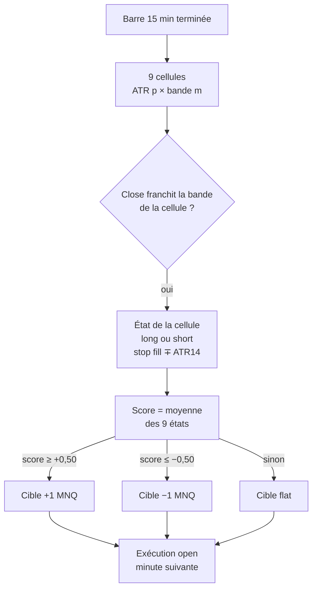

# Fiche signal 04/09 — MNQ ATR trend flip

## 1. Carte d'identité

| Champ | Valeur gelée |
|---|---|
| Instrument / ID | MNQ / `mnq_atr_trend_flip` |
| Idée | entrer lors d'un changement d'état de tendance ajusté de la volatilité |
| Direction | long et short |
| Modèle | ensemble de 9 cellules, vote de positions à `0,50` |
| Signal | SuperTrend-like sur barres 15 min terminées, par cellule |
| Taille exécutée | cible agrégée `−1/0/+1`, soit au plus 1 MNQ |
| Sortie | stop fixe 1 ATR(14) au fill de chaque cellule ; vote agrégé ; hard flatten 16:08 |

## 2. Intuition économique

L'**ATR** (*Average True Range*) mesure l'amplitude récente, gaps compris, dans la même unité que le cours. Sur MNQ, `ATR=80` signifie `80 points`, soit `160 USD` pour un contrat avant coûts ; ce n'est ni un pourcentage ni une prévision directionnelle. Les bandes placées autour du prix s'écartent quand le marché devient agité et se resserrent quand il se calme : il faut donc un mouvement proportionné au régime pour déclarer un changement de tendance. Une clôture qui franchit la bande opposée provoque le **flip**, c'est-à-dire le passage de l'état neutre à long ou short. Un second ATR, gelé à l'entrée, fixe le risque si ce changement est faux. La sleeve exécutée moyenne les positions de 9 variantes voisines (période d'ATR × largeur de bande) et ne détient qu'une cible agrégée `−1`, `0` ou `+1 MNQ`.

### Lecture visuelle des bandes ATR


Les bandes se déplacent avec le prix et s'élargissent avec l'ATR. Un flip n'est reconnu qu'après une clôture qualifiante ; le fill vient ensuite, puis un ATR14 distinct fixe la distance du stop.

## 3. Données et horloge

Construire des barres 15 minutes RTH. Pour chaque cellule `(p, m)`, calculer Wilder ATR(p), `HL2`, bandes de base à `m×ATRp`, avec `p∈{8,10,12}` et `m∈{1,5;1,75;2,0}`, puis les bandes finales récursives sans utiliser la barre future. Le flip est confirmé uniquement à la clôture 15 min ; entrée à l'open minute suivante. Au fill, geler Wilder ATR(14) de la dernière barre 15 min terminée pour le stop.

## 4. Paramètres et raison du choix

| Paramètre | Valeur |
|---|---:|
| ATR de tendance `p` | `{8, 10, 12}` barres 15 min |
| multiplicateur de bande `m` | `{1,5; 1,75; 2,0}` |
| ATR de stop | Wilder 14, commun à toutes les cellules |
| distance stop | 1,0 ATR, commune à toutes les cellules |
| sous-modèles | `3×3 = 9` |
| vote | moyenne des états ; seuil `±0,50`, soit 5 votes nets |
| quantité agrégée | `−1/0/+1 MNQ` |

Le lock n'est plus le point isolé `ATR10 × 1,75`. Il est remplacé par son **voisinage immédiat** : un cran de grille de part et d'autre sur les deux axes du signal, soit 9 cellules centrées sur l'ancien point. Le stop money-management `1 ATR(14)` reste celui du lock MM et s'applique à chaque cellule. La baseline générique 10/3,0 avec sortie sur flip n'est pas la sleeve active.

Ce choix ne regarde pas les performances. Une validation croisée combinatoire menée dans l'IS (10 blocs, 252 découpages) a montré que toutes les règles qui choisissent un cluster d'après son Sharpe sur-ajustent : probabilité de sur-ajustement de 54 à 65 % et rang hors échantillon inférieur à un tirage au hasard. Centrer le cluster sur le lock déjà déclaré n'ajoute donc aucun degré de liberté. Détails : [sélection](../../research/signal_sheet_parameter_refinement/cluster_selection/cluster_selection_cscv.json), [manifeste gelé](../../strategy_registry/psf_mnq/frozen_ensembles/mnq_atr_trend_flip_vote_9.json).

### Surface IS / OOS des deux paramètres

Les carrés bleus repèrent les 9 sous-modèles de l'ensemble gelé. La surface relie uniquement les 25 cellules réellement testées et ne crée aucun backtest intermédiaire. Les deux panneaux partagent la même échelle de Sharpe. Le survol donne Sharpe, PF, maxDD, nombre de trades et pire journée. Données complètes : [`grid_metrics.csv`](../../research/signal_sheet_parameter_refinement/s04/grid_metrics.csv). L'inventaire complet des paramètres, les grilles testées et le récapitulatif restent en section 12.

<!-- PARAMETER_REFINEMENT_VISUALS -->

## 5. Chaîne causale illustrée



## 6. Règles exactes

Dans chaque cellule, au flip haussier, l'état devient long à l'open de la minute suivante avec un stop fixe `fill−ATR14` ; au flip baissier, règle symétrique. Le stop n'est pas recalculé après l'entrée. Pas de target. Le moteur n'accepte pas un fill construit avec l'ATR de la barre en formation.

Chaque cellule tient une position **virtuelle** `−1/0/+1`. La sleeve moyenne les 9 états : cible longue si `score≥0,50`, courte si `score≤−0,50`, sinon flat ; le seuil exact est inclus. Un changement de cible est exécuté à l'open de la minute suivante. Les 9 cellules sont des avis, pas 9 contrats : la position finale reste `−1`, `0` ou `+1 MNQ`.

**Exemple.** Pour une cellule entrée long à `20 000` avec `ATR14=80`, le SL vaut `19 920` et aucun TP n'est placé. Si 5 cellules sont longues et 4 flat, le score vaut `5/9=0,56` : la sleeve détient 1 MNQ. Si 4 sont longues, 1 courte et 4 flat, le score vaut `0,33` : elle est flat.

## 7. Exécution, coûts et ambiguïtés

Tick `0,25` = `0,50 USD`, commission `1,25 USD/côté`, slippage `1 tick/côté`. Les cellules sont virtuelles : les coûts ne sont débités que lorsque la **cible agrégée** change. Un signal sans minute suivante exacte est ignoré. Dernière entrée 15:55, hard flatten agrégé 16:08. L'open du hard-flatten est utilisé ; à défaut, dernière clôture disponible strictement antérieure.

## 8. Pseudocode de réimplémentation

```text
bars15 = resample_RTH_causal(minutes)
pour chaque cellule (p dans [8,10,12], m dans [1.5,1.75,2.0]):
  atr = wilder_TR(bars15, p)
  bands = bandes_finales_récursives(HL2 ± m*atr)
  si close terminé change l'état:
    état = sens du flip ; stop = fill_cellule - état*ATR14_15m_terminé
  flat au stop ou à 16:08
à chaque changement observable:
  score = moyenne(états des 9 cellules)
  cible = +1 si score>=.50, -1 si score<=-.50, sinon 0
  exécuter le changement de cible à l'open minute suivante
```

## 9. Validation historique

- **Historique total — 2019-05-06 au 2026-03-19 :** 2 052 trades agrégés, `10 075 USD` nets, Sharpe `0,424`, PF `1,079`, maxDD `−4 212,50 USD`, pire journée `−1 028,50 USD`.
- **IS — 2019-05-06 au 2023-12-31 :** 1 419 trades agrégés, `4 692 USD` nets, Sharpe `0,354`, PF `1,059`, maxDD `−3 063 USD`.
- **OOS / validation réutilisée — 2024-01-01 au 2026-03-19 :** 633 trades agrégés, `5 383 USD` nets, Sharpe `0,543`, PF `1,114`, maxDD `−4 212,50 USD`. Cette fenêtre a été lue avant le gel : ce n'est pas un OOS prospectif.
- **Comparaison avec l'ancien point `ATR10 × 1,75`**, même définition des métriques : Sharpe IS `0,310`, Sharpe validation `0,800`. Le vote améliore l'IS mais fait nettement moins bien en validation. La cartographie de la section 12 montre que le classement des cellules s'inverse entre les deux périodes sur cette sleeve : le chiffre de validation de l'ancien point n'était pas reproductible par une sélection faite sur l'IS.
- Les Sharpe sont calculés sur le PnL quotidien net ; les couleurs de la vue de la section 4 restent des métriques **par cellule**.

## 10. Checklist et limites

- Tester la récursion exacte des bandes et le warm-up ATR, pour chaque période de cellule.
- Distinguer l'ATR du signal (`p`) et l'ATR14 du stop.
- Vérifier qu'un flip opposé n'invente pas une sortie différente du lock à stop fixe.
- Ne jamais exécuter 9 contrats : seules les transitions de la cible agrégée `−1/0/+1` sont tradées et facturées.
- Pire journée historique `−1 028,50 USD` : c'est la sleeve la plus exposée à une perte journalière, à surveiller face à une limite prop firm.

Sources : [résultats exécutés du vote](../../research/signal_sheet_04_cluster/summary.json), [trades agrégés](../../research/signal_sheet_04_cluster/trades.csv), [manifeste gelé des 9 cellules](../../strategy_registry/psf_mnq/frozen_ensembles/mnq_atr_trend_flip_vote_9.json), [lock MNQ](../../research/locked_four_sleeve_portfolio/locked_four_sleeve_config.json), [spécification gelée](../../strategy_registry/psf_mnq/frozen_baselines/atr_trend_flip.json).

## 11. Equity curves FS et OOS/validation


Le panneau **FS** couvre tout l'historique depuis mai 2019 et repère le début de la validation réutilisée au 1er janvier 2024. Le panneau de droite redémarre à zéro sur cette seconde fenêtre, qui a été lue avant le gel et n'est donc pas un OOS vierge. La courbe provient des transitions réellement exécutées par la cible agrégée, pas d'une moyenne des PnL des 9 cellules.

## 12. Cartographie des paramètres et cluster gelé

La campagne conserve le stop à `1,0 × ATR14` et cartographie uniquement les deux paramètres qui construisent le signal de flip, autour de l'ancien point `ATR10 × 1,75`. Elle sert de base au cluster gelé le 1er novembre 2026 (section 4).

### 12.1 Inventaire complet

| Famille | Paramètre | Valeur actuelle | Statut |
|---|---|---:|---|
| signal | `signal_timeframe` | 15 min | figé |
| signal | `atr_period` | 10 | **testé** |
| signal | `atr_multiplier` | 1,75 | **testé** |
| signal | `atr_method` | Wilder RMA | figé |
| sortie active | `stop_atr` | 1,0 × ATR14 | figé |
| risque | `fixed_quantity` | 1 MNQ | figé |
| risque | `hard_flatten_time` | 16:08 ET | figé |
| risque | `exit_rule` de la spec source | flip opposé, remplacé par l'overlay actif | figé / non exécuté |
| risque | `optional_tightening` | désactivé | figé |
| exécution | `tick_size` / `tick_value_usd` | 0,25 pt / 0,50 USD | figé |
| exécution | `point_value_usd` | 2 USD/point | figé |
| exécution | `commission_per_side_usd` | 1,25 USD | figé |
| exécution | `slippage_ticks_per_side` | 1 tick | figé |
| exécution | `session_timezone` | America/New_York | figé |
| exécution | `rth_start` / `cash_close` | 09:30 / 16:00 | figé |
| exécution | `last_entry_time` / `forced_flatten_time` | 15:55 / 16:08 | figé |
| exécution | `early_close_calendar` | calendrier CME officiel | figé |
| exécution | buffers early close | 5 min entrée / 1 min flatten | figé |
| exécution | `position_policy` | une position, sans pyramiding | figé |
| exécution | `bar_conflict_policy` | stop avant cible | figé |
| exécution | `missing_execution_bar_policy` | signal ignoré | figé |
| exécution | `price_rounding_policy` | arrondi adverse au tick | figé |

Les deux paramètres principaux sont :

- `atr_period` : fixe la vitesse d'adaptation de la volatilité qui déplace les bandes ;
- `atr_multiplier` : fixe directement la largeur des bandes et donc la fréquence des flips.

La distance `stop_atr` influence naturellement le risque, mais elle reste figée ici pour isoler la sensibilité du signal ; sa propre étude money-management est déjà documentée dans la section 4.

### 12.2 Grille et métriques

| Axe | Valeurs testées |
|---|---|
| période ATR du signal | `{6, 8, 10, 12, 14}` |
| multiplicateur des bandes | `{1,25; 1,50; 1,75; 2,00; 2,25}` |

La grille contient **25 combinaisons**. Chaque point est mesuré sur le full sample, l'IS 2019–2023 et la validation 2024–2026 avec Sharpe, profit factor net par trade, max drawdown, nombre de trades et pire journée nette. Pour rendre la surface comparable entre cellules futures à quantité fixe, le Sharpe de cette cartographie est calculé sur la série de PnL quotidien net en dollars ; le Sharpe de tête de fiche est calculé sur les rendements d'equity et peut donc différer légèrement.

Contrôle de référence : `ATR10 × 1,75` avec stop `1 ATR` reproduit `1 460` trades, `4 103,50 USD`, PF `1,049`, maxDD `−3 574 USD` en IS et `659` trades, `8 274 USD`, PF `1,170`, maxDD `−4 056 USD` en validation. Les Sharpe PnL de la grille sont respectivement `0,310` et `0,800`.

### 12.3 Récapitulatif S4

- **Paramètres principaux :** période ATR et multiplicateur des bandes ; stop `1 ATR` figé.
- **Grille :** `5 × 5 = 25` cellules ; `22/25` ont un Sharpe positif à la fois en IS et validation.
- **Zone visuellement stable :** les multiplicateurs `1,25–1,75` restent globalement positifs sur les cinq périodes ; aucune période unique ne porte seule la zone.
- **Fragilité visible :** le multiplicateur `2,25` montre un fort contraste IS/OOS pour les périodes `6` et `8` ; les multiplicateurs `2,0–2,25` perdent nettement du Sharpe de validation malgré des résultats IS souvent élevés.
- **Risque prop firm :** sur toute la grille, la pire journée observée atteint `−1 006 USD` et le maxDD le plus profond `−7 836 USD`, ce qui doit rester visible lors de la future sélection de cluster.
- **Cluster gelé :** `p∈{8,10,12} × m∈{1,5;1,75;2,0}`, 9 cellules centrées sur l'ancien point, retenues sans critère de performance ; vote exécuté en section 9.

