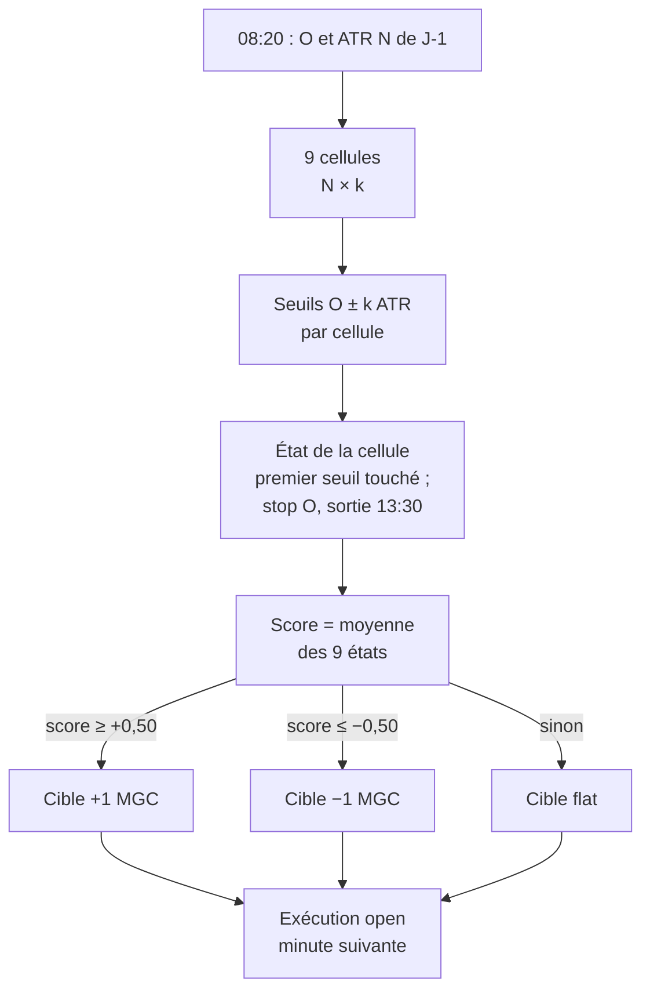

# Fiche signal 05/09 — MGC volatility breakout

## 1. Carte d'identité

| Champ | Valeur gelée |
|---|---|
| Instrument / ID | Micro Gold (`MGC`) / `mgc_volatility_breakout` |
| Idée | suivre une forte expansion depuis l'open COMEX |
| Direction | long et short symétriques |
| Modèle | ensemble de 9 cellules, vote de positions à `0,50` |
| Signal | niveaux ATR connus à l'open par cellule, surveillance minute |
| Taille exécutée | cible agrégée `−1/0/+1`, soit au plus 1 MGC |
| Sortie | stop à l'open RTH par cellule, clôture cash 13:30 ET ; vote agrégé |

## 2. Intuition économique

Une variation supérieure à l'**ATR** (*Average True Range*, amplitude moyenne des séances précédentes) peut révéler une information durable sur l'or. L'ATR est exprimé en points d'or : `ATR=20` correspond à `20 points`, soit `200 USD` par MGC puisque le point vaut `10 USD`; il ne s'agit pas d'une volatilité annualisée. Deux seuils symétriques sont placés autour de l'ouverture COMEX ; le premier touché donne la direction. Le multiple, plus large que sur MNQ, filtre les mouvements ordinaires et ne vise que les séances d'expansion. Le retour à l'open invalide l'impulsion ; il n'y a pas de TP. La sleeve exécutée moyenne les positions de 9 variantes voisines et ne détient qu'une cible agrégée `−1`, `0` ou `+1 MGC`.

### Lecture visuelle de l'ATR breakout


L'open COMEX est le centre et le niveau d'invalidation. Pour la cellule centrale, les deux seuils sont distants de `1,10 × ATR30` ; une volatilité récente plus élevée éloigne donc simultanément l'entrée haute et l'entrée basse.

## 3. Données et horloge

Session MGC : 08:20–13:30 ET. À 08:20, figer `O` et, pour chaque cellule, le Wilder ATR journalier des `N` séances RTH terminées, avec `N∈{20,30,40}`. Niveaux `O±k×ATRN_prev`, avec `k∈{0,9;1,1;1,3}`. Ordres stop surveillés à la minute, cutoff d'entrée 13:25.

## 4. Paramètres et raison du choix

| Paramètre | Valeur |
|---|---:|
| ATR journalier `N` | `{20, 30, 40}` séances |
| multiple `k` | `{0,9; 1,1; 1,3}` |
| stop | open 08:20 |
| sortie | 13:30 |
| sous-modèles | `3×3 = 9` |
| vote | moyenne des états ; seuil `±0,50`, soit 5 votes nets |
| quantité agrégée | `−1/0/+1 MGC` |

Le lock n'est plus le point isolé `30 / 1,10`. Il est remplacé par son **voisinage immédiat** : un cran de grille de part et d'autre sur les deux axes, soit 9 cellules centrées sur l'ancien point, qui était déjà le représentant central pré-déclaré d'un plateau.

Ce choix ne regarde pas les performances. Une validation croisée combinatoire menée dans l'IS (10 blocs, 252 découpages) a montré que toutes les règles qui choisissent un cluster d'après son Sharpe sur-ajustent : probabilité de sur-ajustement de 54 à 65 % et rang hors échantillon inférieur à un tirage au hasard. Centrer le cluster sur le lock déjà déclaré n'ajoute donc aucun degré de liberté. Détails : [sélection](../../research/signal_sheet_parameter_refinement/cluster_selection/cluster_selection_cscv.json), [manifeste gelé](../../strategy_registry/psf_mnq/frozen_ensembles/mgc_volatility_breakout_vote_9.json).

### Surface IS / OOS des deux paramètres

Les carrés bleus repèrent les 9 sous-modèles de l'ensemble gelé. La surface relie uniquement les 25 cellules réellement testées et ne crée aucun backtest intermédiaire. Les deux panneaux partagent la même échelle de Sharpe et se tournent indépendamment. Le survol donne Sharpe, PF, maxDD, nombre de trades et pire journée, et les données complètes restent dans [`grid_metrics.csv`](../../research/signal_sheet_parameter_refinement/s05/grid_metrics.csv). L'inventaire complet des paramètres, les grilles testées et le récapitulatif restent en section 12.

<!-- PARAMETER_REFINEMENT_VISUALS -->

## 5. Chaîne causale illustrée



## 6. Règles exactes

Dans chaque cellule, premier seuil touché = direction ; double touche dans une minute = aucune transaction. Fill au seuil, ou à l'open adverse si le marché gappe au-delà. Stop fixe à l'open RTH ; aucune cible et aucun trailing ATR. Sortie à l'open de 13:30 ; hard flatten 16:08 seulement comme garde ultime.

Chaque cellule tient une position **virtuelle** `−1/0/+1`. La sleeve moyenne les 9 états : cible longue si `score≥0,50`, courte si `score≤−0,50`, sinon flat ; le seuil exact est inclus. Un changement de cible est exécuté à l'open de la minute suivante. Les 9 cellules sont des avis, pas 9 contrats : la position finale reste `−1`, `0` ou `+1 MGC`.

**Exemple.** `O=2 500` et `ATR30_prev=20` donnent, pour la cellule centrale `30 / 1,10`, des seuils `2 522` et `2 478`. Les cellules `k=0,9` touchent plus tôt, celles à `k=1,3` plus tard : la sleeve n'achète que lorsqu'au moins 5 des 9 cellules nettes sont longues.

## 7. Exécution, coûts et ambiguïtés

Tick MGC `0,10` point = `1 USD` ; point `10 USD` ; commission `1,25 USD/côté` ; slippage `1 tick/côté`. Les cellules sont virtuelles : les coûts ne sont débités que lorsque la **cible agrégée** change. Calendrier déterministe COMEX obligatoire pour les jours raccourcis. Stop prioritaire dans une minute ambiguë.

### 7.1 Exécution agrégée par instrument (depuis le 13 novembre 2026)

Cette sleeve n'est plus envoyée seule. Sa position s'additionne à celle de l'autre sleeve MGC (S05 + S06) dans **une seule cible nette MGC** ([Book, section 7](BOOK.md)). Signal, taille et PnL suivi inchangés. Depuis 2019, S05 et S06 n'ont jamais été en sens opposés : en pratique, l'agrégation additionne.

Exemple réel, 7 juin 2024 : S06 est short depuis 08:36 (vente 1 à 2 334,6). S05 passe short à 12:00 : la cible MGC passe à −2 (vente 1 à 2 322,9). S05 sort à 13:31 : la cible revient à −1 (achat 1 à 2 323,8). Flatten à 16:08 (achat 1 à 2 305,9).

## 8. Pseudocode de réimplémentation

```text
O = open 08:20
pour chaque cellule (N dans [20,30,40], k dans [.9,1.1,1.3]):
  atr = Wilder ATR_N des séances finies ; upper/lower = O ± k*atr
  premier touch jusqu'à 13:25 => état ; double touch => aucune entrée
  stop = O ; flat au stop ou à l'open 13:30
à chaque changement observable:
  score = moyenne(états des 9 cellules)
  cible = +1 si score>=.50, -1 si score<=-.50, sinon 0
  exécuter le changement de cible à l'open minute suivante
```

## 9. Validation historique

- **Historique total — 2019-05-06 au 2026-03-19 :** 197 trades agrégés, `3 135,50 USD` nets, Sharpe `0,370`, PF `1,324`, maxDD `−1 622,50 USD`, pire journée `−874,50 USD`.
- **IS — 2019-05-06 au 2023-12-31 :** 132 trades agrégés, `1 418 USD` nets, Sharpe `0,519`, PF `1,332`, maxDD `−1 346 USD`.
- **OOS / validation réutilisée — 2024-01-01 au 2026-03-19 :** 65 trades agrégés, `1 717,50 USD` nets, Sharpe `0,388`, PF `1,317`, maxDD `−1 622,50 USD`. Cette fenêtre a déjà servi au lock précédent : elle n'est pas indépendante.
- **Comparaison avec l'ancien point `30 / 1,10`**, même définition des métriques : Sharpe IS `0,428`, Sharpe validation `0,470`. Le vote améliore l'IS et reste positif en validation, un peu en dessous de l'ancien point.
- La validation ne compte que 65 trades : l'écart entre ces chiffres n'est pas statistiquement significatif.

## 10. Checklist et limites

- Ne pas réutiliser les horaires MNQ : MGC ouvre à 08:20 et clôture à 13:30.
- Reproduire exactement les 9 cellules, le calendrier COMEX et le vote d'une minute de décalage.
- Ne jamais exécuter 9 contrats : seules les transitions de la cible agrégée `−1/0/+1` sont tradées et facturées.
- Sleeve la plus fragile du dossier dans la cartographie des paramètres (sections 4 et 12) ; faible fréquence (environ 29 trades par an).
- Corrélation MGC volatility/gap variable selon les années.

Sources : [résultats exécutés du vote](../../research/signal_sheet_05_cluster/summary.json), [trades agrégés](../../research/signal_sheet_05_cluster/trades.csv), [manifeste gelé des 9 cellules](../../strategy_registry/psf_mnq/frozen_ensembles/mgc_volatility_breakout_vote_9.json), [ancienne configuration du lock](../../research/mgc_final_two_sleeve_lock_20260926/final_lock_config.json).

## 11. Equity curves FS et OOS/validation


Le panneau **FS** couvre tout l'historique depuis mai 2019 et repère le début de la validation réutilisée au 1er janvier 2024. Le panneau de droite redémarre à zéro sur cette seconde fenêtre, qui a été lue avant le gel et n'est donc pas un OOS vierge. La courbe provient des transitions réellement exécutées par la cible agrégée, pas d'une moyenne des PnL des 9 cellules.

## 12. Cartographie des paramètres et cluster gelé

Cette cartographie repart de l'ancien point `ATR30 × 1,10` et sert de base au cluster gelé le 1er novembre 2026 (section 4). Elle utilise la série verrouillée `MGC_v`, l'adaptation de session officielle MGC et les mêmes coûts/fills que la campagne finale.

### 12.1 Inventaire complet

| Famille | Paramètre | Valeur actuelle | Statut |
|---|---|---:|---|
| signal | `signal_timeframe` | 5 min | figé |
| signal | `daily_atr_period` | 30 séances | **testé** |
| signal | `daily_atr_method` | Wilder RMA | figé |
| signal | `entry_atr_multiple` | 1,10 | **testé** |
| signal | `entry_order_type` | resting stop | figé |
| risque | `fixed_quantity` | 1 MGC | figé |
| risque | `hard_flatten_time` | 16:08 ET | figé |
| risque | `stop` | open de session | figé |
| risque | `optional_atr_trail` | désactivé | figé |
| exécution | `tick_size` / `tick_value_usd` | 0,10 pt / 1 USD | figé |
| exécution | `point_value_usd` | 10 USD/point | figé |
| exécution | `commission_per_side_usd` | 1,25 USD | figé |
| exécution | `slippage_ticks_per_side` | 1 tick | figé |
| exécution | `session_timezone` | America/New_York | figé |
| exécution | `rth_start` / `cash_close` | 08:20 / 13:30 | figé |
| exécution | `last_entry_time` / `forced_flatten_time` | 13:25 / 16:08 | figé |
| exécution | `early_close_calendar` | calendrier COMEX déterministe | figé |
| exécution | buffers early close | 5 min entrée / 1 min flatten | figé |
| exécution | `position_policy` | une position, sans pyramiding | figé |
| exécution | `bar_conflict_policy` | stop avant cible | figé |
| exécution | `missing_execution_bar_policy` | signal ignoré | figé |
| exécution | `price_rounding_policy` | arrondi adverse au tick | figé |

Les deux paramètres principaux sont :

- `daily_atr_period` : détermine le régime de volatilité de référence et la stabilité du seuil ;
- `entry_atr_multiple` : détermine l'amplitude minimale du choc et la fréquence de déclenchement.

### 12.2 Grille et métriques

| Axe | Valeurs testées |
|---|---|
| période ATR | `{10, 20, 30, 40, 50}` séances |
| multiple d'entrée | `{0,7; 0,9; 1,1; 1,3; 1,5}` |

Les **25 combinaisons** sont mesurées sur full sample, IS 2019–2023 et validation réutilisée 2024–2026. Par cellule : Sharpe sur PnL quotidien net, PF net par trade, maxDD quotidien, nombre de trades et pire journée nette.

Contrôle de référence : `30 × 1,10` reproduit en IS `134` trades, `1 167 USD`, Sharpe `0,428`, PF `1,266`, maxDD `−1 148 USD` ; en validation `65` trades, `2 073,50 USD`, Sharpe `0,470`, PF `1,404`, maxDD `−1 481,50 USD`. Les petits écarts avec les Sharpes officiels `0,431/0,485` proviennent de la convention PnL quotidien plutôt que rendement d'equity.

### 12.3 Récapitulatif S5

- **Paramètres principaux :** période ATR journalière et multiple d'entrée.
- **Grille :** `5 × 5 = 25` cellules ; `12/25` ont un Sharpe positif sur les deux périodes.
- **Zone visuellement stable :** les multiples `1,1–1,3` forment la continuité la plus nette, particulièrement autour des périodes `20–40`, sans constituer ici une sélection.
- **Fragilité visible :** `0,7` est négatif ou proche de zéro dans presque toute la grille ; plusieurs points à `0,9` et aux périodes longues changent de signe en validation. Les bords `1,5` ont peu de trades et des résultats plus discontinus.
- **Risque prop firm :** pire journée de la grille `−1 167,50 USD`, maxDD le plus profond `−4 867 USD` ; la faible fréquence de certaines cellules rend ces extrêmes peu lissés.
- **Cluster gelé :** `N∈{20,30,40} × k∈{0,9;1,1;1,3}`, 9 cellules centrées sur l'ancien point, retenues sans critère de performance ; vote exécuté en section 9.

