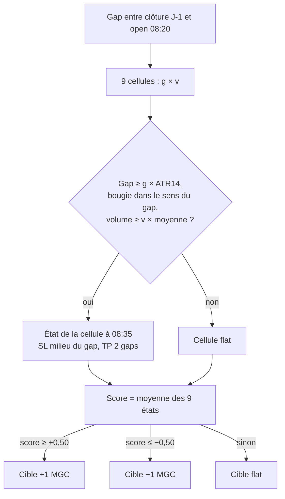

# Fiche signal 06/09 — MGC gap continuation

## 1. Carte d'identité

| Champ | Valeur gelée |
|---|---|
| Instrument / ID | MGC / `mgc_gap_continuation` |
| Idée | suivre un gap confirmé par le premier chandelier et le volume |
| Direction | sens du gap |
| Modèle | ensemble de 9 cellules, vote de positions à `0,50` |
| Signal | première barre 15 min après l'open 08:20, seuils par cellule |
| Taille exécutée | cible agrégée `−1/0/+1`, soit au plus 1 MGC |
| Sortie | stop milieu du gap, cible 2×gap par cellule ; vote agrégé ; hard flatten 16:08 |

## 2. Intuition économique

Un **gap** est l'écart entre la clôture RTH de la veille et l'ouverture COMEX du jour. S'il est assez grand relativement à l'ATR, puis confirmé par une première bougie de même sens et un volume supérieur à la normale, il peut refléter une information nouvelle plutôt qu'un simple manque de liquidité. La réintégration de la moitié du gap invalide cette lecture ; la cible cherche une continuation de deux fois sa taille. La sleeve exécutée moyenne les positions de 9 variantes voisines (seuil de gap × seuil de volume) et ne détient qu'une cible agrégée `−1`, `0` ou `+1 MGC`.

### Lecture visuelle du gap


Le gap est mesuré entre la clôture RTH de J−1 et l'open de 08:20. La première bougie doit confirmer son sens avant l'entrée ; le milieu du gap matérialise l'invalidation et la cible ajoute deux amplitudes de gap au fill.

## 3. Données et horloge

`gap=O_today−C_prev_RTH`; `gap_ratio=abs(gap)/ATR14_prev`. La barre de confirmation MGC est `[08:20,08:35)`. Sa direction doit suivre le gap. Son volume doit dépasser `v×` la moyenne des 20 barres 15 min RTH terminées, et le gap au moins `g×ATR14`, avec `g∈{0,4;0,5;0,6}` et `v∈{0,5;0,6;0,7}` selon la cellule. Signal connu à 08:35, entrée à l'open 08:35 minute.

## 4. Paramètres et raison du choix

| Paramètre | Valeur |
|---|---:|
| minimum gap / ATR14 `g` | `{0,4; 0,5; 0,6}` |
| seuil volume `v` | `{0,5; 0,6; 0,7}` × moyenne |
| confirmation | 15 min |
| lookback volume | 20 barres |
| stop | 50 % de réintégration du gap |
| cible | 2 × taille absolue du gap |
| sous-modèles | `3×3 = 9` |
| vote | moyenne des états ; seuil `±0,50`, soit 5 votes nets |
| quantité agrégée | `−1/0/+1 MGC` |

Le lock n'est plus le point isolé `0,50 / 0,60`. Il est remplacé par son **voisinage immédiat** : un cran de grille de part et d'autre sur les deux axes, soit 9 cellules centrées sur l'ancien point. Toute la grille cartographiée est positive des deux côtés (vue ci-dessous), ce qui en fait la sleeve la plus stable du dossier.

Ce choix ne regarde pas les performances. Une validation croisée combinatoire menée dans l'IS (10 blocs, 252 découpages) a montré que toutes les règles qui choisissent un cluster d'après son Sharpe sur-ajustent : probabilité de sur-ajustement de 54 à 65 % et rang hors échantillon inférieur à un tirage au hasard. Centrer le cluster sur le lock déjà déclaré n'ajoute donc aucun degré de liberté. Détails : [sélection](../../research/signal_sheet_parameter_refinement/cluster_selection/cluster_selection_cscv.json), [manifeste gelé](../../strategy_registry/psf_mnq/frozen_ensembles/mgc_gap_continuation_vote_9.json).

### Surface IS / OOS des deux paramètres

Les carrés bleus repèrent les 9 sous-modèles de l'ensemble gelé. La surface relie uniquement les 25 cellules réellement testées et ne crée aucun backtest intermédiaire. Les deux panneaux partagent la même échelle de Sharpe et se tournent indépendamment. Le survol donne Sharpe, PF, maxDD, nombre de trades et pire journée, et les données complètes restent dans [`grid_metrics.csv`](../../research/signal_sheet_parameter_refinement/s06/grid_metrics.csv). L'inventaire complet des paramètres, les grilles testées et le récapitulatif restent en section 12.

<!-- PARAMETER_REFINEMENT_VISUALS -->

## 5. Chaîne causale illustrée



## 6. Règles exactes

Gap haussier : la première bougie doit clôturer au-dessus de son open ; gap baissier : inverse. Dans chaque cellule, long : `stop=(C_prev+O_today)/2`, `target=entry+2×abs(gap)` ; short symétrique. Un seul signal à l'ouverture ; pas de re-entry.

Chaque cellule tient une position **virtuelle** `−1/0/+1`. La sleeve moyenne les 9 états : cible longue si `score≥0,50`, courte si `score≤−0,50`, sinon flat ; le seuil exact est inclus. Un changement de cible est exécuté à l'open de la minute suivante. Les 9 cellules sont des avis, pas 9 contrats : la position finale reste `−1`, `0` ou `+1 MGC`.

**Exemple.** Clôture veille `2 480`, open `2 500`, gap `+20`. Les cellules dont le seuil de gap et de volume est franchi deviennent longues à 08:35 ; un fill à `2 504` donne SL `2 490` (milieu du gap) et TP `2 544`. Si au moins 5 cellules nettes sont longues, la sleeve achète 1 MGC.

## 7. Exécution, coûts et ambiguïtés

Tick `0,10` = `1 USD`, point `10 USD`, commission `1,25 USD/côté`, slippage `1 tick/côté`. Les cellules sont virtuelles : les coûts ne sont débités que lorsque la **cible agrégée** change. Le timestamp de la spec source mentionne historiquement 09:30/09:45, mais la configuration MGC adaptée et exécutée est bien **08:20/08:35 ET**. Stop avant cible dans une minute ambiguë. Hard flatten 16:08 ou fermeture anticipée COMEX.

### 7.1 Exécution agrégée par instrument (depuis le 13 novembre 2026)

Cette sleeve n'est plus envoyée seule. Sa position s'additionne à celle de l'autre sleeve MGC (S05 + S06) dans **une seule cible nette MGC** ([Book, section 7](BOOK.md)). Signal, taille et PnL suivi inchangés. Depuis 2019, S05 et S06 n'ont jamais été en sens opposés : en pratique, l'agrégation additionne.

Exemple réel, 7 juin 2024 : S06 passe short à 08:36 (vente 1 à 2 334,6). S05 la rejoint à 12:00 : position −2. S05 sort à 13:31 : position −1, celle de S06. Flatten à 16:08 (achat 1 à 2 305,9). S06 garde son propre PnL de la journée.

## 8. Pseudocode de réimplémentation

```text
gap = open_0820 - close_RTH_précédent
pour chaque cellule (g dans [.4,.5,.6], v dans [.5,.6,.7]):
  si abs(gap) >= g*ATR14_précédent et direction(barre 08:20-08:35)==direction(gap)
     et volume>=v*mean(volume15m[-20:]):
    état = direction(gap) à 08:35 ; stop = midpoint(close_prev, open_today)
    target = entry + direction*2*abs(gap) ; flat au stop/target/hard flatten
à chaque changement observable:
  score = moyenne(états des 9 cellules)
  cible = +1 si score>=.50, -1 si score<=-.50, sinon 0
  exécuter le changement de cible à l'open minute suivante
```

## 9. Validation historique

- **Historique total — 2019-05-06 au 2026-03-19 :** 231 trades agrégés, `7 030,50 USD` nets, Sharpe `0,677`, PF `1,504`, maxDD `−1 564,50 USD`, pire journée `−909,50 USD`.
- **IS — 2019-05-06 au 2023-12-31 :** 138 trades agrégés, `3 098 USD` nets, Sharpe `0,878`, PF `1,550`, maxDD `−961,50 USD`.
- **OOS / validation réutilisée — 2024-01-01 au 2026-03-19 :** 93 trades agrégés, `3 932,50 USD` nets, Sharpe `0,732`, PF `1,473`, maxDD `−1 564,50 USD`. Cette fenêtre a déjà servi au lock précédent : elle n'est pas indépendante.
- **Comparaison avec l'ancien point `0,50 / 0,60`**, même définition des métriques : Sharpe IS `0,861`, Sharpe validation `0,844`. Le vote fait légèrement mieux en IS et un peu moins bien en validation ; l'ancien point était aussi le meilleur Sharpe de validation de toute la grille, ce qui rendait ce chiffre optimiste.

## 10. Checklist et limites

- Adapter explicitement les horaires à MGC ; ne pas recopier le texte générique MNQ.
- ATR et close de référence doivent provenir de séances complètes antérieures.
- Tester gap haussier/baissier, volume limite et barre stop+cible, cellule par cellule.
- Ne jamais exécuter 9 contrats : seules les transitions de la cible agrégée `−1/0/+1` sont tradées et facturées.
- Pire journée de validation `−909,50 USD` : à surveiller face à une limite de perte journalière.

Sources : [résultats exécutés du vote](../../research/signal_sheet_06_cluster/summary.json), [trades agrégés](../../research/signal_sheet_06_cluster/trades.csv), [manifeste gelé des 9 cellules](../../strategy_registry/psf_mnq/frozen_ensembles/mgc_gap_continuation_vote_9.json), [ancien override utilisateur](../../research/mgc_final_two_sleeve_lock_20260926/gap_user_override_0_50_0_60.json).

## 11. Equity curves FS et OOS/validation


Le panneau **FS** couvre tout l'historique depuis mai 2019 et repère le début de la validation réutilisée au 1er janvier 2024. Le panneau de droite redémarre à zéro sur cette seconde fenêtre, qui a été lue avant le gel et n'est donc pas un OOS vierge. La courbe provient des transitions réellement exécutées par la cible agrégée, pas d'une moyenne des PnL des 9 cellules.

## 12. Cartographie des paramètres et cluster gelé

Cette cartographie décrit le voisinage de l'ancien point `0,50 × 0,60` et sert de base au cluster gelé le 1er novembre 2026 (section 4). Tous les points utilisent la série verrouillée `MGC_v`, l'adaptation de session COMEX (`08:20–13:30`, dernière entrée `08:35`) et les mêmes coûts, fills et règles causales que la campagne finale.

### 12.1 Inventaire complet

| Famille | Paramètre | Valeur actuelle | Statut |
|---|---|---:|---|
| signal | `signal_timeframe` | 15 min | figé |
| signal | `gap_reference` | open RTH − clôture RTH J−1 | figé |
| signal | `daily_atr_period` | 14 séances | figé |
| signal | `minimum_gap_atr_multiple` | 0,50 | **testé** |
| signal | `confirmation_bar_minutes` | 15 min | figé |
| signal | `volume_average_lookback` | 20 barres | figé |
| signal | `volume_threshold_multiple` | 0,60 | **testé** |
| risque | `fixed_quantity` | 1 MGC | figé |
| risque | `hard_flatten_time` | 16:08 ET | figé |
| risque | `target_gap_multiple` | 2,0 × gap | figé |
| risque | `stop_gap_reentry_fraction` | 0,50 | figé |
| risque | `swing_trail` | désactivé | figé |
| exécution | `tick_size` / `tick_value_usd` | 0,10 pt / 1 USD | figé |
| exécution | `point_value_usd` | 10 USD/point | figé |
| exécution | `commission_per_side_usd` | 1,25 USD | figé |
| exécution | `slippage_ticks_per_side` | 1 tick | figé |
| exécution | `session_timezone` | America/New_York | figé |
| exécution | `rth_start` / `cash_close` | 08:20 / 13:30 | figé |
| exécution | `last_entry_time` / `forced_flatten_time` | 08:35 / 16:08 | figé |
| exécution | `early_close_calendar` | calendrier COMEX déterministe | figé |
| exécution | buffers early close | 5 min entrée / 1 min flatten | figé |
| exécution | `position_policy` | une position, sans pyramiding | figé |
| exécution | `bar_conflict_policy` | stop avant cible | figé |
| exécution | `missing_execution_bar_policy` | signal ignoré | figé |
| exécution | `price_rounding_policy` | arrondi adverse au tick | figé |

Les deux paramètres principaux sont :

- `minimum_gap_atr_multiple` : filtre l'importance du gap relativement au régime de volatilité ;
- `volume_threshold_multiple` : filtre la confirmation par participation et pilote le nombre de signaux.

Les autres leviers plausibles restent figés par construction : `target_gap_multiple` et `stop_gap_reentry_fraction` définissent la géométrie de sortie gelée de la famille, `daily_atr_period` sert uniquement de normalisation au filtre de gap.

### 12.2 Grille et métriques

| Axe | Valeurs testées |
|---|---|
| seuil de gap | `{0,3; 0,4; 0,5; 0,6; 0,7} × ATR14` |
| seuil de volume | `{0,4; 0,5; 0,6; 0,7; 0,8} ×` moyenne 20 barres |

Les **25 combinaisons** sont mesurées sur full sample, IS 2019–2023 et validation réutilisée 2024–2026. Par cellule : Sharpe sur PnL quotidien net, PF net par trade, maxDD quotidien, nombre de trades et pire journée nette. La pire journée est un diagnostic de perte journalière prop firm, pas un calcul de trailing loss intraday.

Contrôle de référence : l'ancien point `0,50 × 0,60` reproduit en IS `141` trades, `3 087,50 USD`, Sharpe `0,861`, PF `1,529`, maxDD `−968 USD`, pire journée `−290,50 USD` ; en validation `95` trades, `4 516,50 USD`, Sharpe `0,844`, PF `1,556`, maxDD `−1 320 USD`, pire journée `−883,50 USD`.

### 12.3 Récapitulatif S6

- **Paramètres principaux :** seuil de gap et seuil de volume.
- **Grille :** `5 × 5 = 25` cellules ; `25/25` ont un Sharpe positif à la fois en IS et en validation. Le Sharpe IS couvre `0,482–0,997` et le Sharpe de validation `0,330–0,844` : la grille entière est un plateau positif, sans zone de signe contraire.
- **Zone visuellement stable :** la colonne `volume 0,60` porte les médianes les plus élevées des deux côtés (`0,814` en IS, `0,794` en validation) et reste la plus homogène sur tous les seuils de gap testés.
- **Fragilité visible :** le seuil `volume 0,80` a la plus faible médiane de validation (`0,423`) pour un IS pourtant élevé ; les seuils de gap `0,60` et `0,70` perdent le plus entre IS et validation (médianes `0,946 → 0,488` et `0,794 → 0,487`). La dégradation est donc plutôt une sur-sélectivité qu'un changement de régime.
- **Mise en garde :** l'ancien point `0,50 × 0,60` est aussi le meilleur Sharpe de validation de toute la grille. La validation ayant été consultée au moment de ce lock, ce rang documentait une cohérence, pas une preuve indépendante.
- **Risque prop firm :** pire journée de la grille `−883,50 USD`, maxDD le plus profond `−2 175 USD`. Le nombre de trades varie de `55` à `254` selon la cellule : les coins les plus sélectifs produisent des extrêmes peu lissés.
- **Cluster gelé :** `g∈{0,4;0,5;0,6} × v∈{0,5;0,6;0,7}`, 9 cellules centrées sur l'ancien point, retenues sans critère de performance ; vote exécuté en section 9.
