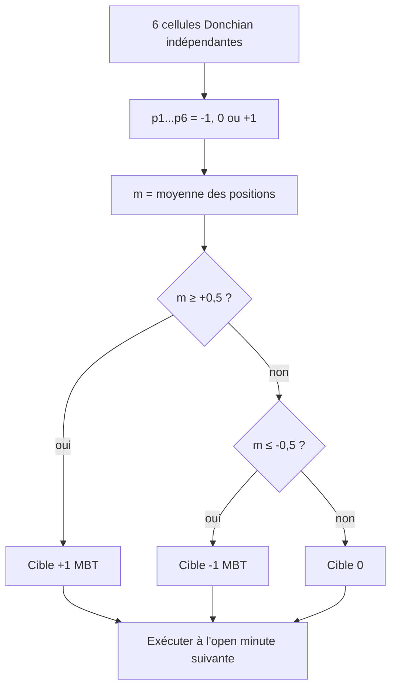

# Fiche signal 07/09 — MBT rolling range breakout

## 1. Carte d'identité

| Champ | Valeur gelée |
|---|---|
| Instrument / ID | Micro Bitcoin (`MBT`) / `mbt_rolling_range_breakout` |
| Idée | continuation après cassure de canaux Donchian |
| Modèle | ensemble de 6 cellules, vote de positions |
| Signal | barres 1 heure RTH, états agrégés chaque minute |
| Taille | cible finale −1/0/+1 MBT |
| Sortie | canal opposé par cellule ; ensemble hard flat 16:08 |

## 2. Intuition économique

Un canal de **Donchian** mémorise le plus haut et le plus bas des `N` barres précédentes. Une clôture au-delà de cet extrême signale une tendance ; un canal opposé plus court, de longueur `M`, donne la sortie. Six couples voisins réduisent la dépendance à un seul paramètre : la sleeve ne choisit pas la meilleure cellule, elle exige qu'au moins la moitié des positions indépendantes s'accordent.

### Lecture visuelle du canal de Donchian


Le canal haut mémorise le plus haut des `N` barres précédentes : une clôture au-dessus déclenche l'état long. Le canal opposé, calculé sur `M` barres, remonte derrière le mouvement et donne la sortie lorsque la clôture repasse en dessous. Les niveaux n'incluent jamais la barre en cours d'évaluation.

## 3. Données et horloge

Chaque cellule travaille sur barres horaires RTH terminées. Le pas de 1 h appartient à la définition gelée de la famille Donchian et n'a pas été promu par comparaison de performances entre plusieurs horizons. Canal d'entrée = extrêmes des `N` barres précédentes, canal de sortie = extrêmes des `M` barres précédentes ; la barre courante est toujours exclue. Chaque cellule produit une position réalisée `p_i∈{-1,0,+1}`. Après chaque clôture minute, calculer la moyenne et exécuter la cible à l'open minute suivante.

## 4. Paramètres et raison du choix

Région gelée : `N∈{20,24}` et `M∈{7,10,12}`, soit 6 cellules. L'ancienne région comptait aussi `M=15`, mais cette longueur de sortie donne exactement les mêmes trades que `M=12` pour toutes les longueurs d'entrée testées (section 12) : elle doublait deux votes sans ajouter d'information. Elle est retirée le 1er novembre 2026 ; le reste de la région est inchangé. Ces valeurs appartiennent à un plateau positif de la grille élargie ; aucune cellule gagnante n'est choisie après observation. Détails : [manifeste gelé](../../strategy_registry/psf_mnq/frozen_ensembles/mbt_rolling_range_breakout_vote_6.json).

### Surface IS / OOS des deux paramètres

Les carrés bleus repèrent les 6 sous-modèles de l'ensemble gelé. La surface relie uniquement les 30 cellules réellement testées et ne crée aucun backtest intermédiaire. Les deux panneaux partagent la même échelle de Sharpe et se tournent indépendamment. Le survol donne Sharpe, PF, maxDD, nombre de trades et pire journée, et les données complètes restent dans [`grid_metrics.csv`](../../research/signal_sheet_parameter_refinement/s07/grid_metrics.csv). L'inventaire complet des paramètres, les grilles testées et le récapitulatif restent en section 12.

<!-- PARAMETER_REFINEMENT_VISUALS -->

## 5. Chaîne causale illustrée



## 6. Règles exactes

Une cellule entre long si la clôture 1h est strictement au-dessus du canal haut précédent, short sous le canal bas. Elle sort sur clôture au-delà du canal de sortie opposé. Le vote agrégé arrondit exactement `±0,5` en s'éloignant de zéro. Les coûts sont payés uniquement quand la cible finale change, pas pour les transactions internes simulées de chaque cellule.

La taille exécutable est **au maximum un contrat MBT** : les six cellules sont des votants, pas six contrats. Exemple : quatre cellules longues, une flat et une short donnent une moyenne `(4−1)/6=0,50`, donc une cible `+1 MBT`. Au passage de `+1` à `−1`, l'ordre porte sur deux contrats pour fermer le long puis ouvrir le short, mais la position finale reste `−1`.

## 7. Exécution, coûts et ambiguïtés

MBT : tick `5` points = `0,50 USD`, point `0,10 USD`, commission `1,41 USD/côté`, slippage nominal `1 tick/côté` (stress : 2). Une décision à la clôture minute ne peut remplir qu'à l'open suivant. Hard flatten 16:08 ET. Pas de journée de roll intraday exclue sur l'export gelé.

### 7.1 Exécution agrégée par instrument (depuis le 13 novembre 2026)

Cette sleeve n'est plus envoyée seule. Sa position s'additionne à celles des autres sleeves MBT (S07 + S08 + S09) dans **une seule cible nette MBT**, de −3 à +3 contrats ([Book, section 7](BOOK.md)). Signal, taille et PnL suivi inchangés.

S07 et S08 sont dans le même sens 83 % du temps où S07 est en position : la cible MBT est souvent à +2 ou −2.

**Limite Topstep.** Un MBT compte pour 1 lot. Au premier palier XFA (2 lots), deux sleeves MBT dans le même sens remplissent déjà la limite : une troisième entrée, MBT ou micro, est réduite ou refusée tant que la place n'est pas libérée ([Book, exemple 5](BOOK.md)).

## 8. Pseudocode de réimplémentation

```text
cells = produit({20,24}, {7,10,12})
pour chaque cellule: mettre à jour sa position avec canaux décalés d'une barre
à chaque close minute:
  mean_pos = mean(cell.position)
  target = +1 si mean_pos>=.5, -1 si mean_pos<=-.5, sinon 0
  si target != position_agrégée: trader la différence à l'open suivant
à 16:08: target=0
```

## 9. Validation historique

- **Historique total — 2021-05-03 au 2026-10-02 :** 461 trades agrégés, `2 082,48 USD` nets, Sharpe `0,473`, PF `1,141`, maxDD `−1 285,80 USD`, pire journée `−451,32 USD`.
- **Legacy IS — 2021-05-03 au 2025-05-28 :** 318 trades agrégés, `1 135,24 USD` nets, Sharpe `0,390`, PF `1,119`, maxDD `−1 285,80 USD`.
- **Legacy OOS réutilisé — 2025-05-29 au 2026-10-02 :** 143 trades agrégés, `947,24 USD` nets, Sharpe `0,638`, PF `1,183`, maxDD `−896,24 USD`. Consulté lors du freeze, donc non indépendant.
- **Effet du retrait du doublon**, sur la fenêtre 2024-01-03 → 2026-10-02 de l'ancien vote : mêmes 288 trades, `2 049 USD` contre `1 993 USD`, Sharpe `0,695` contre `0,673`.
- **Prospectif véritable :** commence après le 2 octobre 2026.

## 10. Checklist et limites

- Décaler les canaux : inclure la barre de breakout dans son propre canal invalide la règle.
- Maintenir 6 états de cellule, puis agréger les **positions**, pas les signaux bruts.
- Tester les égalités ±0,5 et les changements +1→−1 (deux côtés de contrat).
- Historique MBT court et régime crypto changeant ; validation prospective nécessaire.

Sources : [résultats exécutés du vote](../../research/signal_sheet_07_cluster/summary.json), [manifeste gelé des 6 cellules](../../strategy_registry/psf_mnq/frozen_ensembles/mbt_rolling_range_breakout_vote_6.json), [ancien manifeste ensemble](../../research/mbt_three_sleeve_freeze_20261004/vote_ensemble/ensemble_manifest.json), [rapport freeze](../../research/mbt_three_sleeve_freeze_20261004/REPORT.md).

## 11. Equity curves FS et legacy OOS


Le panneau **FS** couvre désormais tout l'historique exécuté, de mai 2021 à octobre 2026. Le panneau de droite redémarre à zéro au 29 mai 2025 sur le legacy OOS ; ce bloc ayant participé au freeze, il est affiché comme **réutilisé**. La cible agrégée reste limitée à un contrat MBT.


## 12. Cartographie des paramètres et cluster gelé

Cette cartographie élargit la grille d'origine autour de l'ancienne région `N∈{20,24} × M∈{7,10,12,15}` et a mis en évidence le doublon `M=15`, retiré du cluster gelé le 1er novembre 2026 (section 4). **Chaque point de grille est une cellule isolée**, pas le vote agrégé de la sleeve : elle décrit le paysage dont la région a été extraite, pas la performance exécutable de S7. Toutes les cellules utilisent la série `MBT_v`, l'adaptation MBT (`tick 5 pts`, `point 0,10 USD`, commission `1,41 USD`/côté) et les sessions avec rolls exclus.

### 12.1 Inventaire complet

| Famille | Paramètre | Valeur actuelle | Statut |
|---|---|---:|---|
| signal | `signal_timeframe` | 1 h | figé |
| signal | `entry_channel_length` | région `{20, 24}` | **testé** |
| signal | `exit_channel_length` | région `{7, 10, 12, 15}` | **testé** |
| signal | `breakout_confirmation` | clôture au-delà du canal précédent | figé |
| risque | `fixed_quantity` | 1 MBT par cellule | figé |
| risque | `hard_flatten_time` | 16:08 ET | figé |
| risque | `exit_rule` | clôture dans le canal opposé | figé |
| risque | `atr_position_sizing` | désactivé, un contrat fixe | figé |
| exécution | `tick_size` / `tick_value_usd` | 5 pts / 0,50 USD | figé |
| exécution | `point_value_usd` | 0,10 USD/point | figé |
| exécution | `commission_per_side_usd` | 1,41 USD | figé |
| exécution | `slippage_ticks_per_side` | 1 tick | figé |
| exécution | `session_timezone` | America/New_York | figé |
| exécution | `rth_start` / `cash_close` | 09:30 / 16:00 | figé |
| exécution | `last_entry_time` / `forced_flatten_time` | 15:55 / 16:08 | figé |
| exécution | `early_close_calendar` | fenêtre US complète observée | figé |
| exécution | buffers early close | 5 min entrée / 1 min flatten | figé |
| exécution | `position_policy` | une position, sans pyramiding | figé |
| exécution | `bar_conflict_policy` | stop avant cible | figé |
| exécution | `missing_execution_bar_policy` | signal ignoré | figé |
| exécution | `price_rounding_policy` | arrondi adverse au tick | figé |
| ensemble | seuil de vote | ≥ 1/2 des cellules | figé, hors périmètre |

Les deux paramètres principaux sont :

- `entry_channel_length` : fixe la maturité du breakout exigé avant l'entrée ;
- `exit_channel_length` : fixe la vitesse de restitution des gains et la durée des tendances captées.

Le pas horaire et la règle de confirmation appartiennent à la définition gelée de la famille Donchian et ne sont pas mis en compétition ici.

### 12.2 Grille et métriques

| Axe | Valeurs testées |
|---|---|
| canal d'entrée `N` | `{16, 20, 24, 28, 32}` barres 1 h |
| canal de sortie `M` | `{5, 7, 10, 12, 15, 18}` barres 1 h |

Les **30 combinaisons** sont mesurées sur full sample, legacy IS `2021-05-03 → 2025-05-28` et legacy OOS `2025-05-29 → 2026-10-02`. Par cellule : Sharpe sur PnL quotidien net, PF net par trade, maxDD quotidien, nombre de trades et pire journée nette.

Contrôle de référence : les 8 cellules de l'ancienne région, doublon `M=15` compris, sont toutes présentes dans la grille et restent positives des deux côtés. Exemple du couple nominal `20 / 10` : en legacy IS `318` trades, `946,74 USD`, Sharpe `0,327`, PF `1,098`, maxDD `−1 339,56 USD` ; en legacy OOS `143` trades, `1 167,24 USD`, Sharpe `0,798`, PF `1,236`, maxDD `−862,68 USD`.

### 12.3 Récapitulatif S7

- **Paramètres principaux :** longueur du canal d'entrée et longueur du canal de sortie.
- **Grille :** `5 × 6 = 30` cellules ; `12/30` ont un Sharpe positif à la fois en legacy IS et en legacy OOS.
- **Observation structurante :** ces 12 cellules sont exactement les colonnes `N = 20` et `N = 24`. Hors de ces deux longueurs d'entrée, le legacy IS devient négatif quel que soit le canal de sortie (médianes `−0,058` à `N=16`, `−0,190` à `N=28`, `−0,292` à `N=32`). La région gelée coïncide donc avec la totalité de la zone positive IS de la grille élargie, ce qui est une crête étroite et non un plateau large.
- **Axe de sortie peu discriminant :** à `N` fixé, les cellules `M = 12`, `15` et `18` donnent des résultats strictement identiques — le canal opposé long ne se déclenche quasiment jamais avant la sortie de séance, et l'axe devient inerte au-delà de `M ≈ 12`. Les médianes de sortie s'étalent sur `0,529–0,573` en OOS contre `0,361–0,758` pour l'axe d'entrée : la performance est pilotée par `N`, pas par `M`.
- **Mise en garde sur le legacy OOS :** **toutes** les cellules de la grille ont un Sharpe OOS positif (`0,346` à `0,798`), y compris celles dont l'IS est franchement négatif. Cette période est favorable au mécanisme dans son ensemble ; elle ne discrimine donc pas les cellules entre elles et ne peut pas servir à valider la région. Elle a de plus été consultée pendant le freeze.
- **Risque prop firm :** pire journée de la grille `−535,32 USD`, maxDD le plus profond `−2 715,92 USD`, pour `117` à `378` trades par cellule.
- **Cluster gelé :** `N∈{20,24} × M∈{7,10,12}`, 6 cellules : l'ancienne région sans son doublon ; vote exécuté en section 9.
