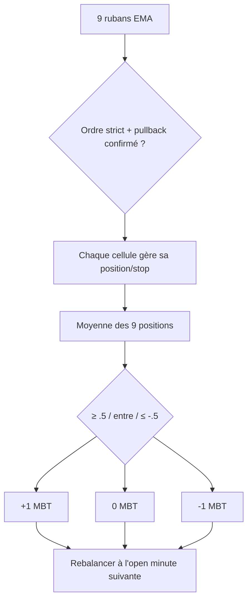

# Fiche signal 08/09 — MBT trend pullback MA structure

## 1. Carte d'identité

| Champ | Valeur gelée |
|---|---|
| Instrument / ID | MBT / `mbt_trend_pullback_ma_structure` |
| Idée | acheter/vendre un pullback dans une structure d'EMA ordonnée |
| Modèle | ensemble de 9 cellules, vote de positions |
| Signal | 15 min, exécution agrégée minute suivante |
| Taille | cible finale −1/0/+1 MBT |
| Sortie cellule | croisement EMA8/EMA21, stop EMA lente, hard flatten |

## 2. Intuition économique

Une **EMA** est une moyenne mobile qui donne davantage de poids aux prix récents. Cinq EMA strictement ordonnées, des plus rapides aux plus lentes, représentent une tendance persistante. Un retour du prix vers les deux EMA rapides est le **pullback** : il offre un point d'entrée plus proche de la zone d'invalidation qu'une poursuite immédiate. Le vote de neuf rubans voisins cherche un accord structurel plutôt qu'une période « optimale ».

### Lecture visuelle du ruban d'EMA


Dans une tendance haussière, les EMA rapides restent au-dessus des lentes. Le prix revient temporairement vers la zone rapide sans casser la structure, puis repart : ce couple pullback/reprise est le motif recherché. Le short inverse exactement l'ordre des courbes.

## 3. Données et horloge

Base nominale EMA `[8,13,21,34,55]` sur clôtures 15 min. Cet horizon appartient à la définition gelée et n'a pas été sélectionné après une compétition 5/15/30/60 minutes. Pour une cellule `(f,s)`, utiliser `[round(8f), round(13f), 21, round(34s), round(55s)]`, puis imposer des périodes entières strictement croissantes, minimum 2. Long si EMA strictement décroissantes en vitesse (`e1>e2>...>e5`), la barre chevauche la zone e1–e2 et clôture au-dessus de e2 ; short symétrique.

## 4. Paramètres et raison du choix

`f∈{0,50;0,60;0,75}` et `s∈{0,75;1,00;1,25}`, soit 9 rubans. Région gelée choisie pour sa continuité sur la grille, cartographiée en section 12, pas pour une cellule unique. Elle est regelée à l'identique le 1er novembre 2026 et réexécutée sur tout l'historique avec le moteur de vote commun aux sleeves S2 à S9 ([manifeste gelé](../../strategy_registry/psf_mnq/frozen_ensembles/mbt_trend_pullback_ma_structure_vote_9.json)).

### Surface IS / OOS des deux paramètres

Les carrés bleus repèrent les 9 sous-modèles de l'ensemble gelé. La surface relie uniquement les 25 cellules réellement testées et ne crée aucun backtest intermédiaire. Les deux panneaux partagent la même échelle de Sharpe et se tournent indépendamment. Le survol donne Sharpe, PF, maxDD, nombre de trades et pire journée, et les données complètes restent dans [`grid_metrics.csv`](../../research/signal_sheet_parameter_refinement/s08/grid_metrics.csv). L'inventaire complet des paramètres, les grilles testées et le récapitulatif restent en section 12.

<!-- PARAMETER_REFINEMENT_VISUALS -->

## 5. Chaîne causale illustrée



## 6. Règles exactes

Une cellule entre au premier pullback qualifiant sans position. Stop initial à l'EMA la plus lente de la barre signal, puis mise à jour monotone sur barres terminées. Sortie de tendance lorsque l'EMA rapide croise l'EMA21 contre la position. Les neuf positions réalisées sont moyennées ; seuils d'ensemble ±0,5, égalité vers l'extérieur.

La taille exécutable est **−1, 0 ou +1 MBT**, jamais neuf contrats. Exemple : six cellules longues et trois flat donnent `m=6/9=0,67`, donc une cible `+1`. Pour un long de cellule, le SL initial est l'EMA la plus lente ; il ne peut ensuite que remonter. Il n'y a pas de TP fixe : la sortie vient du stop EMA, du croisement contraire ou du hard flatten.

## 7. Exécution, coûts et ambiguïtés

Tick `5` points = `0,50 USD`, point `0,10 USD`, commission `1,41 USD/côté`, slippage `1 tick/côté`. Les cellules sont des calculateurs d'état ; seul le changement de position agrégée paie les coûts. Hard flatten 16:08 ET.

## 8. Pseudocode de réimplémentation

```text
pour f dans [.50,.60,.75], s dans [.75,1,1.25]:
  periods = strictly_increasing(round([8f,13f,21,34s,55s]))
  calculer EMA sur bars15 terminées
  si ordre + overlap zone rapide + close confirmé: entrer cellule
  gérer stop EMA lente monotone et exit crossover rapide/21
m = moyenne des 9 positions; discrétiser à -1/0/+1; fill open minute suivante
```

## 9. Validation historique

- **Historique total — 2021-05-03 au 2026-10-02 :** 1 142 trades agrégés, `3 900,06 USD` nets, Sharpe `0,642`, PF `1,124`, maxDD `−1 653,28 USD`, pire journée `−533,64 USD`.
- **Legacy IS — 2021-05-03 au 2025-05-28 :** 780 trades agrégés, `2 535,40 USD` nets, Sharpe `0,621`, PF `1,125`, maxDD `−1 542,56 USD`.
- **Legacy OOS réutilisé — 2025-05-29 au 2026-10-02 :** 362 trades agrégés, `1 364,66 USD` nets, Sharpe `0,687`, PF `1,123`, maxDD `−1 653,28 USD`. Consulté lors du freeze, donc non indépendant.
- **Contrôle :** sur la fenêtre 2024-01-03 → 2026-10-02, la réexécution reproduit exactement l'ancien vote (693 trades, `3 465,24 USD`, jours identiques à 100 %).
- C'est la sleeve MBT la plus active ; rolling/trend sont corrélées (`0,629` dans l'étude de freeze).
- **Prospectif véritable :** commence après le 2 octobre 2026.

## 10. Checklist et limites

- Reproduire exactement l'arrondi et la contrainte de périodes croissantes.
- Une barre de pullback doit être terminée avant le fill.
- Ne pas facturer chaque cellule comme un contrat réel ; seule la cible agrégée est exécutable.
- La corrélation élevée avec rolling justifie le suivi d'exposition cluster, même si la référence active garde les deux sleeves.

Sources : [résultats exécutés du vote](../../research/signal_sheet_08_cluster/summary.json), [manifeste gelé des 9 cellules](../../strategy_registry/psf_mnq/frozen_ensembles/mbt_trend_pullback_ma_structure_vote_9.json), [code de grille](../../research/mbt_strategy_heatmaps_20261003/run_mbt_heatmaps.py), [ancien manifeste ensemble](../../research/mbt_three_sleeve_freeze_20261004/vote_ensemble/ensemble_manifest.json).

## 11. Equity curves FS et legacy OOS


Le panneau **FS** couvre désormais tout l'historique exécuté, de mai 2021 à octobre 2026. Le panneau de droite redémarre à zéro au 29 mai 2025 sur le legacy OOS réutilisé pendant le freeze. La cible agrégée reste limitée à un contrat MBT.


## 12. Cartographie des paramètres et cluster gelé

Cette cartographie élargit la grille d'origine autour de la région gelée `f∈{0,50;0,60;0,75} × s∈{0,75;1,00;1,25}`, regelée à l'identique le 1er novembre 2026 (section 4). **Chaque point de grille est un ruban isolé**, pas le vote agrégé des neuf cellules : elle décrit le paysage dont la région a été extraite, pas la performance exécutable de S8. Toutes les cellules utilisent la série `MBT_v`, l'adaptation MBT (`tick 5 pts`, `point 0,10 USD`, commission `1,41 USD`/côté) et les sessions avec rolls exclus.

### 12.1 Inventaire complet

| Famille | Paramètre | Valeur actuelle | Statut |
|---|---|---:|---|
| signal | `signal_timeframe` | 15 min | figé |
| signal | `ema_periods` base nominale | `[8, 13, 21, 34, 55]` | figé comme référence du ruban |
| signal | `fast_pair_scale` `f` | région `{0,50; 0,60; 0,75}` | **testé** |
| signal | `slow_tail_scale` `s` | région `{0,75; 1,00; 1,25}` | **testé** |
| signal | pivot `ema_3` | 21 périodes, non redimensionné | figé |
| signal | `pullback_zone` | entre EMA rapide 1 et EMA rapide 2 | figé |
| signal | `confirmation_close` | clôture au-delà de la 2ᵉ EMA rapide | figé |
| risque | `fixed_quantity` | 1 MBT par cellule | figé |
| risque | `hard_flatten_time` | 16:08 ET | figé |
| risque | `trend_exit` | croisement EMA rapide 1 / EMA 21 | figé |
| risque | `protective_stop` | EMA lente monotone | figé |
| exécution | `tick_size` / `tick_value_usd` | 5 pts / 0,50 USD | figé |
| exécution | `point_value_usd` | 0,10 USD/point | figé |
| exécution | `commission_per_side_usd` | 1,41 USD | figé |
| exécution | `slippage_ticks_per_side` | 1 tick | figé |
| exécution | `session_timezone` | America/New_York | figé |
| exécution | `rth_start` / `cash_close` | 09:30 / 16:00 | figé |
| exécution | `last_entry_time` / `forced_flatten_time` | 15:55 / 16:08 | figé |
| exécution | `early_close_calendar` | fenêtre US complète observée | figé |
| exécution | buffers early close | 5 min entrée / 1 min flatten | figé |
| exécution | `position_policy` | une position, sans pyramiding | figé |
| exécution | `bar_conflict_policy` | stop avant cible | figé |
| exécution | `missing_execution_bar_policy` | signal ignoré | figé |
| exécution | `price_rounding_policy` | arrondi adverse au tick | figé |
| ensemble | seuil de vote | ≥ 1/2 des cellules | figé, hors périmètre |

Les deux paramètres principaux sont :

- `fast_pair_scale` : contrôle la réactivité des EMA rapides au pullback et à la reprise ;
- `slow_tail_scale` : contrôle la persistance de la structure de tendance de fond.

Ces deux échelles sont les seuls leviers continus du ruban : l'EMA pivot `21` reste commune à toutes les cellules, et la règle de pullback/confirmation est structurelle.

### 12.2 Grille et métriques

| Axe | Valeurs testées |
|---|---|
| échelle rapide `f` | `{0,40; 0,50; 0,60; 0,75; 0,90}` |
| échelle lente `s` | `{0,60; 0,75; 1,00; 1,25; 1,50}` |

Chaque couple produit un ruban entier, par exemple `f=0,60 ; s=1,00 → [5, 8, 21, 34, 55]` et `f=0,40 ; s=1,50 → [3, 5, 21, 51, 82]`, avec périodes entières strictement croissantes et minimum 2.

Les **25 combinaisons** sont mesurées sur full sample, legacy IS `2021-05-03 → 2025-05-28` et legacy OOS `2025-05-29 → 2026-10-02`. Par cellule : Sharpe sur PnL quotidien net, PF net par trade, maxDD quotidien, nombre de trades et pire journée nette.

Contrôle de référence : les 9 cellules de la région gelée sont toutes présentes dans la grille et positives des deux côtés. Exemple du ruban nominal `f=0,60 ; s=1,00` : en legacy IS `773` trades, `2 294,14 USD`, Sharpe `0,564`, PF `1,110`, maxDD `−1 587,88 USD` ; en legacy OOS `354` trades, `1 351,22 USD`, Sharpe `0,673`, PF `1,121`, maxDD `−1 787,64 USD`.

### 12.3 Récapitulatif S8

- **Paramètres principaux :** échelle des EMA rapides et échelle des EMA lentes.
- **Grille :** `5 × 5 = 25` cellules ; `23/25` ont un Sharpe positif à la fois en legacy IS et en legacy OOS. Le Sharpe IS reste faible mais positif partout (`0,010` à `0,642`) ; le Sharpe OOS couvre `−0,427` à `1,068`.
- **Zone visuellement stable :** le bloc `f ∈ [0,50 ; 0,60]` porte les meilleures médianes des deux côtés (`0,475–0,491` en IS, `0,628–0,718` en OOS) et contient la région gelée. Les neuf cellules gelées sont positives des deux côtés sans exception.
- **Fragilité visible :** les deux seules cellules non positives sont `f=0,90 ; s=0,60` (`IS 0,010 / OOS −0,427`) et `f=0,90 ; s=0,75` (`IS 0,228 / OOS −0,003`). Plus largement, la colonne `s = 0,60` est la plus faible de la grille (médiane OOS `0,059`) : raccourcir la queue lente dégrade la structure de tendance avant que l'échelle rapide ne compte. Le bord `f = 0,90` est le second point faible.
- **Asymétrie IS/OOS :** la colonne `s = 1,25` a la meilleure médiane OOS (`0,832`) mais pas la meilleure médiane IS (`0,366` contre `0,484` pour `s = 0,75`). Le classement des cellules n'est donc pas stable d'une période à l'autre ; le legacy OOS a par ailleurs été consulté pendant le freeze et ne constitue pas un test indépendant.
- **Risque prop firm :** pire journée de la grille `−672,64 USD`, maxDD le plus profond `−3 239,16 USD`, pour `294` à `1 046` trades par cellule — c'est la sleeve la plus active des trois sleeves MBT.
- **Cluster gelé :** `f∈{0,50;0,60;0,75} × s∈{0,75;1,00;1,25}`, 9 rubans, région inchangée ; vote exécuté sur tout l'historique en section 9.
