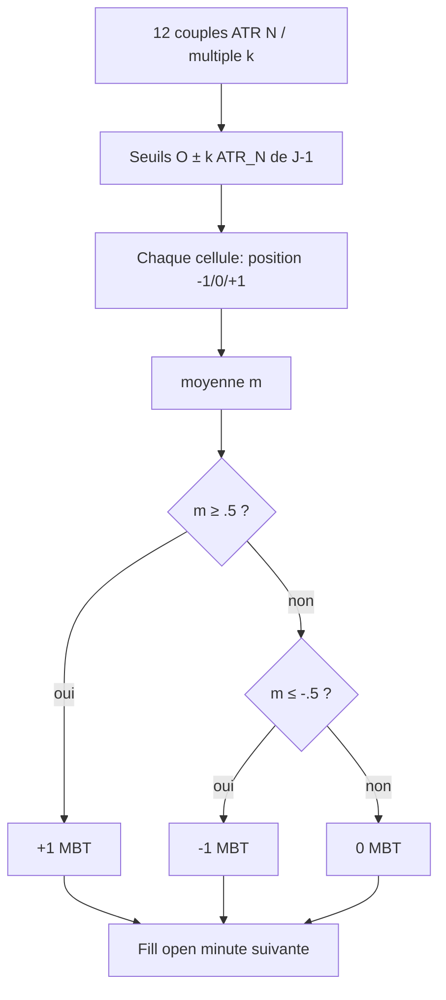

# Fiche signal 09/09 — MBT volatility breakout

## 1. Carte d'identité

| Champ | Valeur gelée |
|---|---|
| Instrument / ID | MBT / `mbt_volatility_breakout` |
| Idée | expansion depuis l'open, normalisée par l'ATR journalier |
| Modèle | ensemble de 12 cellules, vote de positions |
| Signal | seuils session par cellule, états agrégés chaque minute |
| Taille | cible finale −1/0/+1 MBT |
| Sortie cellule | stop open de séance, sortie cash ; ensemble flat 16:08 |

## 2. Intuition économique

Le mécanisme est le même que les breakouts MNQ/MGC : l'**ATR** mesure l'amplitude des journées terminées dans l'unité du cours. Sur MBT, `ATR=4 000` signifie `4 000 points`, soit `400 USD` par contrat puisque le point vaut `0,10 USD`; ce n'est pas une volatilité annualisée. Deux seuils symétriques sont placés autour de l'open. L'incertitude paramétrique est ici traitée explicitement : douze couples période `N` / multiple `k` votent. Une position agrégée n'existe que si au moins la moitié du domaine gelé est déjà engagée dans le même sens.

### Lecture visuelle de l'ATR breakout


Chaque cellule construit ses propres seuils avec son couple `(N,k)`. La figure représente une cellule ; dans la sleeve réelle, douze cellules produisent ensuite des positions qui sont agrégées en une seule cible MBT.

## 3. Données et horloge

Pour chaque cellule, figer l'open RTH et le Wilder ATR de la dernière séance terminée. Placer des seuils symétriques `O±k×ATR_N`. Surveiller les touches avec les minutes. Chaque cellule applique ses propres entrées, stop à l'open et sortie ; l'ensemble observe ensuite leurs positions réalisées.

## 4. Paramètres et raison du choix

`k∈{0,30;0,40;0,60}` et `N∈{10,14,20,30}`, soit 12 cellules. Le rectangle gelé exclut les zones plus fragiles de la grille large, cartographiée en section 12, et évite de retenir le meilleur couple après observation. Il est regelé à l'identique le 1er novembre 2026 et réexécuté sur tout l'historique avec le moteur de vote commun aux sleeves S2 à S9 ([manifeste gelé](../../strategy_registry/psf_mnq/frozen_ensembles/mbt_volatility_breakout_vote_12.json)).

### Surface IS / OOS des deux paramètres

Les carrés bleus repèrent les 12 sous-modèles de l'ensemble gelé. La surface relie uniquement les 36 cellules réellement testées et ne crée aucun backtest intermédiaire. Les deux panneaux partagent la même échelle de Sharpe et se tournent indépendamment. Le survol donne Sharpe, PF, maxDD, nombre de trades et pire journée, et les données complètes restent dans [`grid_metrics.csv`](../../research/signal_sheet_parameter_refinement/s09/grid_metrics.csv). L'inventaire complet des paramètres, les grilles testées et le récapitulatif restent en section 12.

<!-- PARAMETER_REFINEMENT_VISUALS -->

## 5. Chaîne causale illustrée



## 6. Règles exactes

Dans chaque cellule, premier seuil touché gagne ; double touche minute = annulation pour cette cellule. Stop à l'open RTH. Les positions, et non les alertes, sont moyennées. `m>=0,5 → +1`, `m<=−0,5 → −1`, sinon flat. Une inversion +1→−1 représente deux côtés exécutés.

La position finale est limitée à **un MBT**. Exemple : pour une cellule avec `O=100 000`, `ATR20=4 000` et `k=0,40`, les seuils sont `101 600` et `98 400`; le SL reste `100 000` et il n'y a pas de TP fixe. Si sept des douze cellules sont longues et les autres flat, `m=7/12=0,58` et la sleeve détient `+1 MBT`.

## 7. Exécution, coûts et ambiguïtés

Tick `5` points = `0,50 USD`, point `0,10 USD`, commission `1,41 USD/côté`, slippage nominal `1 tick/côté`, stress 2. Décision à la close minute, fill à l'open suivante. Exact ±0,5 arrondi vers la position. Hard flatten 16:08.

### 7.1 Exécution agrégée par instrument (depuis le 13 novembre 2026)

Cette sleeve n'est plus envoyée seule. Sa position s'additionne à celles des autres sleeves MBT (S07 + S08 + S09) dans **une seule cible nette MBT**, de −3 à +3 contrats ([Book, section 6](BOOK.md)). Signal, taille et PnL suivi inchangés.

Exemple réel, 1er mars 2024 : S08 passe long à 09:46 (achat 1 à 62 520). S09 passe short à 10:39 : la cible nette revient à 0, on vend 1 à 62 210 et le compte est plat. S08 sort à 11:01 : la cible devient −1, on vend 1 à 62 075. S08 repasse long à 12:46 : la cible revient à 0. S09 sort à 13:42 : la cible devient +1. Flatten à 16:08. Les sleeves gardent chacune leur PnL, mais le compte n'est jamais long et short à la fois.

**Limite Topstep.** Un MBT compte pour 1 lot. Au premier palier XFA (2 lots), deux sleeves MBT dans le même sens remplissent déjà la limite : une troisième entrée, MBT ou micro, est réduite ou refusée tant que la place n'est pas libérée ([Book, exemple 5](BOOK.md)).

## 8. Pseudocode de réimplémentation

```text
cells = produit(N=[10,14,20,30], k=[.30,.40,.60])
pour chaque cellule et séance:
  atr = Wilder_ATR_N(J-1); seuils = O ± k*atr
  premier touch => position; double touch => aucune entrée; stop=O
à chaque close minute:
  target = discretize(mean(cell.position), thresholds ±.5)
  exécuter delta à l'open minute suivante
hard flatten à 16:08
```

## 9. Validation historique

- **Historique total — 2021-05-03 au 2026-10-02 :** 668 trades agrégés, `4 916,24 USD` nets, Sharpe `0,874`, PF `1,213`, maxDD `−1 916,40 USD`, pire journée `−229,32 USD`.
- **Legacy IS — 2021-05-03 au 2025-05-28 :** 447 trades agrégés, `4 989,46 USD` nets, Sharpe `1,314`, PF `1,356`, maxDD `−984,84 USD`.
- **Legacy OOS réutilisé — 2025-05-29 au 2026-10-02 :** 221 trades agrégés, `−73,22 USD` nets, Sharpe `−0,040`, PF `0,992`, maxDD `−1 525,38 USD`. Consulté lors du freeze, donc non indépendant.
- **Le vote ne gagne rien sur le legacy OOS**, alors que ses douze cellules y sont toutes positives prises isolément (section 12) : le vote majoritaire ne restitue pas leur performance sur cette période.
- **Contrôle :** la réexécution reproduit exactement l'ancien vote sur 2024-01-03 → 2026-10-02 (442 trades, `2 244,06 USD`, Sharpe `0,565`). Ce chiffre, affiché jusqu'ici, mélangeait 17 mois d'IS et 16 mois d'OOS et masquait l'absence de gain sur le legacy OOS seul.
- **Prospectif véritable :** commence après le 2 octobre 2026.

## 10. Checklist et limites

- ATR calculé sur jours terminés et séparément pour les 4 périodes.
- Tester doubles touches cellule par cellule et transitions agrégées multi-côtés.
- Ne jamais moyenner les PnL fractionnaires en production : l'ensemble de positions est la règle exécutable.
- Cette sleeve est le principal doublon externe des breakouts MNQ ; surveiller les expositions communes.
- **Point bloquant :** vote agrégé nul sur le legacy OOS (Sharpe `−0,040`). La sleeve doit être revue avant toute nouvelle allocation.

Sources : [résultats exécutés du vote](../../research/signal_sheet_09_cluster/summary.json), [manifeste gelé des 12 cellules](../../strategy_registry/psf_mnq/frozen_ensembles/mbt_volatility_breakout_vote_12.json), [ancien manifeste ensemble](../../research/mbt_three_sleeve_freeze_20261004/vote_ensemble/ensemble_manifest.json), [étude Topstep 6 vs 9](../../research/mbt_nine_sleeve_topstep_20261004/REPORT.md).

## 11. Equity curves FS et legacy OOS


Le panneau **FS** couvre désormais tout l'historique exécuté, de mai 2021 à octobre 2026. Le panneau de droite redémarre à zéro au 29 mai 2025 sur le legacy OOS réutilisé pendant le freeze. La cible agrégée reste limitée à un contrat MBT.


## 12. Cartographie des paramètres et cluster gelé

Cette cartographie élargit la grille d'origine autour de la région gelée `N∈{10,14,20,30} × k∈{0,30;0,40;0,60}`, regelée à l'identique le 1er novembre 2026 (section 4). **Chaque point de grille est une cellule isolée**, pas le vote agrégé des douze cellules : elle décrit le paysage dont le rectangle a été extrait, pas la performance exécutable de S9. Toutes les cellules utilisent la série `MBT_v`, l'adaptation MBT (`tick 5 pts`, `point 0,10 USD`, commission `1,41 USD`/côté) et les sessions avec rolls exclus.

### 12.1 Inventaire complet

| Famille | Paramètre | Valeur actuelle | Statut |
|---|---|---:|---|
| signal | `signal_timeframe` | 5 min | figé |
| signal | `daily_atr_period` `N` | région `{10, 14, 20, 30}` | **testé** |
| signal | `daily_atr_method` | Wilder RMA | figé |
| signal | `entry_atr_multiple` `k` | région `{0,30; 0,40; 0,60}` | **testé** |
| signal | `entry_order_type` | resting stop | figé |
| risque | `fixed_quantity` | 1 MBT par cellule | figé |
| risque | `hard_flatten_time` | 16:08 ET | figé |
| risque | `stop` | open de séance | figé |
| risque | `optional_atr_trail` | désactivé | figé |
| exécution | `tick_size` / `tick_value_usd` | 5 pts / 0,50 USD | figé |
| exécution | `point_value_usd` | 0,10 USD/point | figé |
| exécution | `commission_per_side_usd` | 1,41 USD | figé |
| exécution | `slippage_ticks_per_side` | 1 tick | figé |
| exécution | `session_timezone` | America/New_York | figé |
| exécution | `rth_start` / `cash_close` | 09:30 / 16:00 | figé |
| exécution | `last_entry_time` / `forced_flatten_time` | 15:55 / 16:08 | figé |
| exécution | `early_close_calendar` | fenêtre US complète observée | figé |
| exécution | buffers early close | 5 min entrée / 1 min flatten | figé |
| exécution | `position_policy` | une position, sans pyramiding | figé |
| exécution | `bar_conflict_policy` | stop avant cible | figé |
| exécution | `missing_execution_bar_policy` | signal ignoré | figé |
| exécution | `price_rounding_policy` | arrondi adverse au tick | figé |
| ensemble | seuil de vote | ≥ 1/2 des cellules | figé, hors périmètre |

Les deux paramètres principaux sont :

- `daily_atr_period` : fixe l'horizon du régime de volatilité utilisé pour normaliser le mouvement ;
- `entry_atr_multiple` : fixe la distance de déclenchement et le compromis fréquence/sélectivité.

Le stop à l'open de séance et la sortie cash définissent la géométrie gelée de la famille breakout et ne sont pas mis en compétition ici.

### 12.2 Grille et métriques

| Axe | Valeurs testées |
|---|---|
| période ATR `N` | `{7, 10, 14, 20, 30, 40}` séances |
| multiple d'entrée `k` | `{0,2; 0,3; 0,4; 0,5; 0,6; 0,8}` |

Les **36 combinaisons** sont mesurées sur full sample, legacy IS `2021-05-03 → 2025-05-28` et legacy OOS `2025-05-29 → 2026-10-02`. Par cellule : Sharpe sur PnL quotidien net, PF net par trade, maxDD quotidien, nombre de trades et pire journée nette.

Contrôle de référence : les 12 cellules du rectangle gelé sont toutes présentes dans la grille et positives des deux côtés. Exemple du couple `N=14 ; k=0,60` : en legacy IS `280` trades, `2 589,40 USD`, Sharpe `0,877`, PF `1,295`, maxDD `−911,46 USD` ; en legacy OOS `122` trades, `524,46 USD`, Sharpe `0,379`, PF `1,115`, maxDD `−1 230,72 USD`.

### 12.3 Récapitulatif S9

- **Paramètres principaux :** période ATR journalière et multiple d'entrée.
- **Grille :** `6 × 6 = 36` cellules ; `31/36` ont un Sharpe positif à la fois en legacy IS et en legacy OOS. Le Sharpe IS est positif sur **toute** la grille (`0,102` à `1,553`) ; le Sharpe OOS couvre `−0,980` à `1,227`.
- **Zone visuellement stable :** l'axe des périodes est peu discriminant (médianes OOS comprises entre `0,430` et `0,605` de `N=7` à `N=40`) ; c'est le multiple qui porte l'information. Les multiples `0,30` à `0,60` restent positifs des deux côtés sur toutes les périodes, et les douze cellules gelées sont positives sans exception (`IS 0,876–1,355`, `OOS 0,236–0,834`).
- **Fragilité visible :** les cinq seules cellules non positives sont la colonne `k = 0,20`, hors région gelée. Son profil est net : `~320` trades en legacy OOS pour un PF de `0,854` à `1,006` et un Sharpe OOS de `−0,980` à `−0,001`, alors que son IS reste élevé (`1,054` à `1,232`). À ce seuil, le signal capte surtout du bruit dont les coûts absorbent la marge ; c'est le bord fragile le plus clair des quatre fiches.
- **Inversion IS/OOS :** la colonne `k = 0,80` a la meilleure médiane OOS de la grille (`1,085`) et la pire médiane IS (`0,274`), tandis que `k = 0,30` fait l'inverse (`IS 1,334 / OOS 0,609`). Le classement des multiples s'inverse donc entre les deux périodes, ce qui déconseille de lire le legacy OOS comme un départage — d'autant qu'il a été consulté pendant le freeze.
- **Risque prop firm :** pire journée de la grille `−332,32 USD`, maxDD le plus profond `−2 891,72 USD`, pour `59` à `716` trades par cellule.
- **Cluster gelé :** `N∈{10,14,20,30} × k∈{0,30;0,40;0,60}`, 12 cellules, région inchangée ; vote exécuté sur tout l'historique en section 9, nul sur le legacy OOS.
