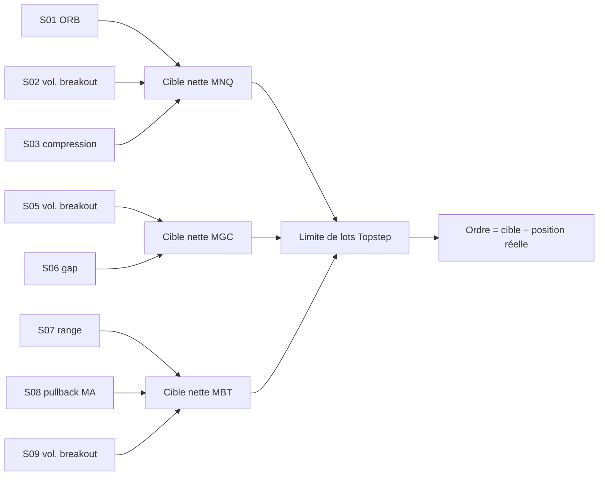

# Book — portefeuille des neuf sleeves

> **Note du 21 novembre 2026.** Les sections 1 à 5 sont maintenant calculées sur MNQ `v.0` (le contrat le plus échangé, celui que trade la production), ajusté en arrière de l'écart de roll. Sont repris : les huit sleeves du lock `eight_sleeve_equal_contract_reference_20261121`, plus S04 (en shadow) reconstruite sur la même donnée. MGC et MBT ne changent pas. Sur `c.0`, le book à 9 sleeves faisait `36 240,96 USD` (Sharpe `1,509`, drawdown `−6 594,74 USD`), et le book actif à 8 sleeves `30 857,96 USD` (Sharpe `1,712`). La section 7 (netting) garde ses exemples d'origine. Référence : [`ACTIVE_EIGHT_SLEEVES.md`](../ACTIVE_EIGHT_SLEEVES.md).
>
> **Note du 3 novembre 2026.** Ce book décrit la référence à neuf sleeves du 1er novembre 2026. La référence active compte désormais huit sleeves : `S04` est passée en shadow ([`ACTIVE_EIGHT_SLEEVES.md`](../ACTIVE_EIGHT_SLEEVES.md)). Sans S04, la section 5 donne déjà le book restant : `30 858 USD`, Sharpe `1,712` (recalculé le 15 novembre ; `31 661 USD` et `1,751` avec l'ancien S01 et le calendrier MNQ).
>
> **Note du 13 novembre 2026.** Les huit sleeves actives ne sont plus exécutées séparément. Elles sont **agrégées par instrument** : une seule position nette sur MNQ, MGC et MBT (section 7). Les signaux et les tailles ne changent pas.
>
> **Note du 15 novembre 2026, mise à jour le même jour.** Les sections 1 à 5 sont désormais calculées avec le S01 de la fiche 01 (ensemble ATR 18) et sur le calendrier union de 572 séances : les huit sleeves du lock du 15 novembre, plus S04 (en shadow) reprise du lock du 1er novembre. La version précédente utilisait le ledger historique `baseline_fixed` (ATR 14 × q_high {90, 95}, 261 trades sur 2024-01 → 2026-03 contre 208) et le calendrier MNQ. La section 7 (netting) garde ses chiffres d'origine, calculés avec `baseline_fixed`. La référence active est désormais `eight_sleeve_equal_contract_reference_20261115` ([`ACTIVE_EIGHT_SLEEVES.md`](../ACTIVE_EIGHT_SLEEVES.md)) : S01 de la fiche 01, calendrier union de 572 séances. Le book à 8 sleeves y fait `30 858 USD`, Sharpe `1,712`, drawdown `−5 870 USD`. Les mêmes chiffres figurent dans [l'audit, phase 1](../../audit_20261115/01_calendrier.md). **L'exemple 2 de la section 7 (31 janvier 2024) repose sur un trade S01 qui n'existe pas dans la sleeve de référence** : il illustre toujours correctement la mécanique du netting, mais pas un jour réel du book. Les exemples 1 et 5 restent des trades de la référence.

## 1. Construction et périmètre

Le book additionne une copie exécutable de chaque sleeve : quatre MNQ, deux MGC et trois MBT, sans pondération fractionnaire. Il correspond à la référence `nine_sleeve_equal_contract_reference_20261101`, dans laquelle les sleeves 2 à 9 exécutent leurs ensembles de vote gelés, avec S01 = ensemble ATR 18 de la fiche 01. Depuis le 21 novembre, les quatre sleeves MNQ sont calculées sur MNQ `v.0` ajusté, comme dans le lock du 21 novembre. Les chiffres de cette section utilisent la fenêtre commune du **2 janvier 2024 au 19 mars 2026** (572 séances, calendrier union) et les PnL quotidiens nets de coûts nominaux. Cette fenêtre rend les comparaisons cohérentes ; elle ne constitue pas un nouvel OOS indépendant.

Sur cette fenêtre, le book à neuf sleeves cumule `36 503,46 USD`, avec une volatilité quotidienne de `655,15 USD`, un pire jour de `−1 664,46 USD` et un drawdown maximal clôture-à-clôture de `−6 334,28 USD` (Sharpe `1,546`). Sans S04, le book actif à huit sleeves fait `31 639,46 USD`, Sharpe `1,782`, drawdown `−5 457,54 USD`. La référence du 4 octobre 2026 affichait `43 225,22 USD` et un drawdown de `−6 014,42 USD` sur la même fenêtre (ancien S01, calendrier MNQ) : les anciens points S3–S6 y avaient été choisis, ce qui rendait ces chiffres optimistes. Ces pertes historiques ne bornent pas la perte future : gaps, slippage, liquidité ou défaillance d'exécution peuvent faire dépasser un stop théorique.

## 2. Matrice de corrélation

La matrice est la corrélation de Pearson des **PnL quotidiens**, jours sans trade inclus. Les blocs les plus liés sont `S05–S06` (`0,66`, deux stratégies MGC), `S07–S08` (`0,62`, deux modèles MBT de tendance) et `S02–S04` (`0,54`, deux moteurs MNQ directionnels). Une corrélation faible n'empêche pas des pertes simultanées lors d'un choc ; elle décrit uniquement la co-mouvance moyenne observée.

| Code | Sleeve |
|---|---|
| S01 | MNQ ORB + VWAP + ATR |
| S02 | MNQ volatility breakout |
| S03 | MNQ compression breakout |
| S04 | MNQ ATR trend flip |
| S05 | MGC volatility breakout |
| S06 | MGC gap continuation |
| S07 | MBT rolling range breakout |
| S08 | MBT trend pullback MA structure |
| S09 | MBT volatility breakout |

## 3. Book risk — stops et risque prévu

Le **risque prévu** ci-dessous est la distance entre le fill et le niveau d'invalidation, convertie en dollars. C'est une estimation ex ante, pas une perte maximale garantie : un ordre stop peut être exécuté plus loin en cas de gap. Pour les sleeves 2 à 9, les cellules internes n'équivalent pas à plusieurs contrats : seule la cible agrégée `−1/0/+1` est tradée, et elle sort lorsque le vote repasse sous son seuil, ce qui peut arriver avant ou après les stops des cellules.

| Sleeve | Stop-loss structurel | Risque prévu par position exécutable |
|---|---|---|
| S01 | Oui — sous l'opening range | budget visé `≤ 250 USD` par trade ; quantité entière réduite quand le stop s'éloigne |
| S02 | Oui dans chaque cellule — open RTH | environ `k × ATR_n × 2 USD` par cellule, `k∈{0,5;0,6}` ; aucun montant unique pour le vote agrégé |
| S03 | Oui dans chaque cellule — extrême opposé de la setup | `(setup_range + b ticks) × 2 USD` par cellule ; le vote ne porte jamais plus d'un MNQ |
| S04 | Oui dans chaque cellule — fixe à 1 ATR14 | `ATR14 × 2 USD` au fill de chaque cellule ; le vote peut sortir avant le stop |
| S05 | Oui dans chaque cellule — open COMEX | environ `k × ATR_N × 10 USD` par cellule, `k∈{0,9;1,1;1,3}` ; aucun montant unique pour le vote |
| S06 | Oui dans chaque cellule — milieu du gap | `|fill − milieu du gap| × 10 USD` par cellule ; dépend du gap et de la barre de confirmation |
| S07 | Non, pas de stop prix unique | sortie par canal opposé puis hard flatten ; perte intraday non bornée par un SL fixe |
| S08 | Oui dans chaque cellule, pas au niveau agrégé | distance fill–EMA lente variable ; le vote peut modifier la cible avant/après les stops internes |
| S09 | Oui dans chaque cellule — open RTH | environ `k × ATR_N × 0,10 USD` par cellule active ; aucun montant unique pour le vote agrégé |

## 4. Book risk — risque réalisé sur la fenêtre commune

| Sleeve | Vol. quotidienne | Pire jour | Max drawdown | Contribution au risque du book |
|---|---:|---:|---:|---:|
| S01 | 131,58 USD | −249,00 USD | −891,50 USD | 4,8 % |
| S02 | 278,55 USD | −1 138,00 USD | −3 692,00 USD | 32,2 % |
| S03 | 58,82 USD | −268,50 USD | −940,50 USD | 3,1 % |
| S04 | 277,34 USD | −823,50 USD | −4 657,00 USD | 30,7 % |
| S05 | 122,88 USD | −874,50 USD | −1 622,50 USD | 5,6 % |
| S06 | 149,08 USD | −909,50 USD | −1 564,50 USD | 7,3 % |
| S07 | 73,36 USD | −355,32 USD | −1 285,80 USD | 3,5 % |
| S08 | 105,16 USD | −533,64 USD | −1 542,56 USD | 5,8 % |
| S09 | 99,36 USD | −229,32 USD | −1 916,40 USD | 7,1 % |

La contribution au risque est la contribution marginale à la variance quotidienne du book equal-contract ; elle tient donc compte à la fois de la volatilité propre et des corrélations. `S02` et `S04` concentrent ensemble environ `62,9 %` du risque observé. Le contrôle opérationnel doit aussi agréger les expositions par instrument : quatre contrats MNQ peuvent être simultanément orientés dans le même sens, auxquels peut s'ajouter le MBT directionnel.

## 5. Analyse leave-one-out

Cette analyse retire **une seule sleeve à la fois**, sans réoptimiser les huit restantes. Elle est strictement bornée à la période de recherche commune du **2 janvier 2024 au 19 mars 2026** : toute donnée ajoutée après cette date est exclue par un filtre et un contrôle de bornes dans le script de génération. La ligne pointillée du graphique représente le book complet.

| Sleeve retirée | PnL du book restant | Variation de PnL | Sharpe annualisé | Max drawdown | Variation du drawdown |
|---|---:|---:|---:|---:|---:|
| S01 | 30 967,46 USD | −5 536,00 USD | 1,351 | −6 601,28 USD | −267,00 USD |
| S02 | 26 229,96 USD | −10 273,50 USD | 1,515 | −5 638,86 USD | +695,42 USD |
| S03 | 35 624,96 USD | −878,50 USD | 1,551 | −6 572,78 USD | −238,50 USD |
| S04 | 31 639,46 USD | −4 864,00 USD | 1,782 | −5 457,54 USD | +876,74 USD |
| S05 | 34 785,96 USD | −1 717,50 USD | 1,534 | −6 152,28 USD | +182,00 USD |
| S06 | 32 570,96 USD | −3 932,50 USD | 1,450 | −6 468,28 USD | −134,00 USD |
| S07 | 34 294,38 USD | −2 209,08 USD | 1,496 | −6 205,76 USD | +128,52 USD |
| S08 | 32 368,38 USD | −4 135,08 USD | 1,437 | −6 601,60 USD | −267,32 USD |
| S09 | 33 546,16 USD | −2 957,30 USD | 1,513 | −6 187,24 USD | +147,04 USD |

Le book complet affiche un PnL de `36 503,46 USD`, un Sharpe annualisé de `1,546` et un drawdown maximal de `−6 334,28 USD`. Toutes les sleeves ont une contribution nette positive sur cette fenêtre : en retirer une diminue donc toujours le PnL final. `S04` est le principal compromis rendement/risque : son retrait réduit le PnL, mais améliore le Sharpe (`1,782`) et le drawdown. Retirer `S02` améliore aussi le drawdown (`+695 USD`), mais plus le Sharpe (`1,515`) : sur `v.0`, son rendement compense son risque. À l'inverse, retirer `S01`, `S03`, `S06` ou `S08` dégrade le drawdown malgré la baisse d'exposition ; ces sleeves apportent une diversification utile sur cette fenêtre. `S03` a la plus faible contribution au PnL, mais son retrait aggrave le drawdown. Le gain de `S09` sur cette fenêtre provient surtout de 2024 et du début 2025 : son vote est nul sur son legacy OOS (fiche 09).

Une variation de drawdown positive signifie que le drawdown devient moins sévère ; une variation négative signifie qu'il se dégrade. Cette analyse est descriptive et rétrospective : elle mesure la dépendance historique du book à chaque sleeve, sans valider une nouvelle allocation.

## 6. Book retenu à 8 sleeves : trois signaux par instrument

*Ajouté le 21 novembre 2026. Calcul et contrôles : [`build_three_signals.py`](../../research/book_three_signals_20261121/build_three_signals.py), résultats : [`results.json`](../../research/book_three_signals_20261121/results.json).*

Les sections 1 à 5 décrivent les neuf sleeves sur la fenêtre commune 2024–2026. Cette section prend le **book retenu** : les huit sleeves du lock `eight_sleeve_equal_contract_reference_20261121`, sans S04. Elle le suit sur **tout l'historique disponible (FS)**. Comme l'exécution est agrégée par instrument (section 7), ce book se lit comme **trois signaux** :

- **MNQ** = S01 + S02 + S03 ;
- **MGC** = S05 + S06 ;
- **MBT** = S07 + S08 + S09.

Chaque signal est la somme des PnL quotidiens nets de ses sleeves (equal contract, avant netting : le netting change le PnL de la fenêtre 2024–2026 de `+28 USD`).

**Contrôle de cohérence :** sur la fenêtre du lock (2 janvier 2024 au 19 mars 2026), les huit séries reconstruites ici sont identiques au centime au `daily_pnl.csv` du lock, et le book y vaut bien `31 639,46 USD`.

**Périmètre.**

- **Calendrier :** union des calendriers des trois instruments, du **6 mai 2019 au 19 mars 2026**, soit 1 775 séances. Le 19 mars 2026 est la fin de la donnée MNQ figée.
- **Entrée de MBT :** le signal MBT n'existe qu'à partir du **3 mai 2021**. Avant cette date, le book ne compte que MNQ et MGC.
- **Sharpe :** un signal se mesure sur le calendrier de son instrument, le book sur le calendrier union. Sharpe = `√252 × moyenne / écart-type` du PnL quotidien en USD.
- **Données au-delà du 19 mars 2026 :** l'historique MBT se prolonge jusqu'au 2 octobre 2026 (fiches 07 à 09), mais il n'est pas repris ici, pour garder une fin commune aux trois signaux.

**IS et OOS.** Chaque sleeve a sa propre date de fin d'IS :

| Sleeves | Fin de l'IS |
|---|---|
| S01 | 27 février 2024 |
| S02, S03, S05, S06 | 31 décembre 2023 |
| S07, S08, S09 | 28 mai 2025 |

Une période est donc classée :

- **IS** quand toutes les sleeves du signal (ou du book) sont dans leur IS ;
- **OOS** quand toutes en sont sorties ;
- **mixte** sinon.

Ces OOS ont tous été consultés avant le gel des ensembles de vote : ce sont des **OOS réutilisés**, pas des lectures prospectives. Les chiffres IS contiennent en outre le biais de sélection des paramètres.

### 6.1 Le book FS

| Période | Dates | Séances | PnL net | PnL annualisé | Sharpe | Max drawdown | Pire jour |
|---|---|---:|---:|---:|---:|---:|---:|
| FS | 2019-05-06 → 2026-03-19 | 1 775 | 66 583,10 USD | 9 453 USD | **1,68** | −5 457,54 USD | −1 655,96 USD |
| IS (les 8 sleeves en IS) | 2019-05-06 → 2023-12-29 | 1 203 | 34 943,64 USD | 7 320 USD | 1,73 | −3 529,50 USD | −967,46 USD |
| Mixte (MNQ et MGC en OOS, MBT en IS) | 2024-01-02 → 2025-05-28 | 363 | 18 690,96 USD | 12 976 USD | 1,83 | −5 457,54 USD | −1 655,96 USD |
| OOS réutilisé (les 8 sleeves hors IS) | 2025-05-29 → 2026-03-19 | 209 | 12 948,50 USD | 15 613 USD | 1,74 | −3 768,54 USD | −1 395,46 USD |

Le Sharpe du book reste stable d'une période à l'autre : `1,73` en IS, `1,83` en mixte et `1,74` en OOS. La part du PnL portée par les cinq meilleurs jours reste modérée (`22 %` du PnL FS).

Le PnL annualisé, lui, double entre l'IS et l'OOS. La volatilité quotidienne double aussi, de `266` à `565 USD`, et le Sharpe ne bouge donc pas. Il y a deux raisons :

- **l'entrée de MBT en 2021** ajoute un troisième signal ;
- **le nombre de contrats est fixe** : quand les prix du Nasdaq, de l'or et du bitcoin montent, le PnL et le risque en USD augmentent avec eux.

Le pire drawdown FS, `−5 457,54 USD`, tombe dans la période mixte, en 2024–2025. C'est le drawdown publié pour le lock sur la fenêtre 2024–2026.

### 6.2 Les trois signaux

| Signal | Période | Dates | Séances | PnL net | PnL annualisé | Sharpe | Max drawdown | Pire jour |
|---|---|---|---:|---:|---:|---:|---:|---:|
| MNQ | FS | 2019-05-06 → 2026-03-19 | 1 774 | 43 975,50 USD | 6 247 USD | **1,43** | −4 655,00 USD | −1 138,00 USD |
| MNQ | IS | 2019-05-06 → 2023-12-29 | 1 203 | 27 287,50 USD | 5 716 USD | 1,48 | −4 655,00 USD | −1 052,50 USD |
| MNQ | Mixte (S01 encore en IS) | 2024-01-02 → 2024-02-27 | 41 | −131,50 USD | — | — | −1 285,50 USD | −569,00 USD |
| MNQ | OOS réutilisé | 2024-02-28 → 2026-03-19 | 530 | 16 819,50 USD | 7 997 USD | 1,50 | −3 524,00 USD | −1 138,00 USD |
| MGC | FS | 2019-05-06 → 2026-03-19 | 1 775 | 10 166,00 USD | 1 443 USD | **0,61** | −2 121,50 USD | −1 247,00 USD |
| MGC | IS | 2019-05-06 → 2023-12-29 | 1 203 | 4 516,00 USD | 946 USD | 0,96 | −1 107,50 USD | −365,50 USD |
| MGC | OOS réutilisé | 2024-01-02 → 2026-03-19 | 572 | 5 650,00 USD | 2 489 USD | 0,63 | −2 121,50 USD | −1 247,00 USD |
| MBT | FS | 2021-05-03 → 2026-03-19 | 952 | 12 441,60 USD | 3 293 USD | **1,13** | −2 426,58 USD | −968,46 USD |
| MBT | IS | 2021-05-03 → 2025-05-28 | 759 | 8 660,10 USD | 2 875 USD | 1,09 | −2 426,58 USD | −968,46 USD |
| MBT | OOS réutilisé | 2025-05-29 → 2026-03-19 | 193 | 3 781,50 USD | 4 938 USD | 1,29 | −1 708,04 USD | −582,96 USD |

Le Sharpe de la période mixte MNQ (41 séances) n'est pas calculé : il serait sans signification sur deux mois.

- **MNQ porte le book** : `66 %` du PnL FS. Son Sharpe ne se dégrade pas hors de l'IS (`1,48` en IS, `1,50` en OOS réutilisé). En OOS, ses cinq meilleurs jours font toutefois `55 %` de son PnL.
- **MGC est le signal le plus fragile.** Son Sharpe passe de `0,96` en IS à `0,63` en OOS. Surtout, son OOS tient à quelques jours : les cinq meilleurs rapportent `9 491,50 USD`, dont `4 373 USD` le seul 30 janvier 2026, pour un OOS total de `5 650 USD`. Sans ces cinq jours, l'OOS est négatif. Du 1er janvier 2024 au 30 septembre 2025, le signal perd `1 598 USD` ; tout son gain OOS vient du marché de l'or d'octobre 2025 à mars 2026.
- **MBT tient hors de son IS** (`1,09` puis `1,29`), mais sur 193 séances seulement. Ses cinq meilleurs jours dépassent son PnL OOS total (`119 %`), et S09 est à zéro sur son propre OOS (fiche 09).

### 6.3 Corrélation des trois signaux

Corrélation de Pearson des PnL quotidiens, jours sans trade inclus, sur le calendrier union (0 quand l'instrument ne cote pas), sur la période où les trois signaux existent.

**Du 3 mai 2021 au 19 mars 2026 (1 261 séances) :**

| | MNQ | MGC | MBT |
|---|---:|---:|---:|
| **MNQ** | 1 | −0,02 | 0,16 |
| **MGC** | −0,02 | 1 | 0,02 |
| **MBT** | 0,16 | 0,02 | 1 |

**Stabilité dans le temps :**

| Période | Séances | MNQ–MGC | MNQ–MBT | MGC–MBT |
|---|---:|---:|---:|---:|
| 2021-05-03 → 2023-12-29 | 689 | 0,00 | 0,06 | 0,07 |
| 2024-01-02 → 2026-03-19 | 572 | −0,03 | 0,21 | 0,01 |

**MGC est indépendant des deux autres** dans les deux sous-périodes. **MNQ et MBT ne le sont qu'en partie** : leur corrélation est faible mais positive, et elle monte de `0,06` à `0,21` depuis 2024, période où Nasdaq et bitcoin ont souvent bougé ensemble. Traiter les trois signaux comme indépendants est une bonne approximation pour MGC ; pour MNQ–MBT, elle sous-estime un peu le risque commun.

**Ce que coûte cette corrélation.** Sur 2021–2026, le book fait un Sharpe de `1,92`. Avec des signaux non corrélés (mêmes moyennes, mêmes volatilités), il ferait `2,01` : la corrélation entre instruments coûte environ `0,09` de Sharpe. Si les huit sleeves étaient indépendantes entre elles, le book ferait `2,29`.

L'essentiel de la redondance est donc **à l'intérieur de chaque instrument** : par exemple `S05–S06` à `0,66` et `S07–S08` à `0,62` (section 2). C'est pourquoi la bonne unité de diversification est le signal par instrument, et non la sleeve. Une corrélation moyenne faible ne garantit pas l'absence de pertes simultanées lors d'un choc.

## 7. Exécution agrégée par instrument (netting)

*Anciennement section 6 : les règles gelées `netting_rule_20261115.json`, `netting_rule_20261115_r2.json` et `netting_rule_20261121_r3.json` y renvoient sous ce numéro.*

*Ajouté le 13 novembre 2026. Étude complète : [clôture de la campagne](../../research/book_aggregation_risk_r1_20261112/HYPOTHESIS_CLOSURE.md).*

### 7.1 Pourquoi

Un compte de futures ne peut pas être long et short sur le même contrat. Si les sleeves d'un même instrument étaient envoyées comme des comptes indépendants, leurs ordres se compenseraient chez le broker de façon incontrôlée, et leurs stops et flattens se marcheraient dessus. On calcule donc **une seule position par instrument**, et c'est elle qu'on envoie.

### 7.2 La règle

| Instrument | Sleeves agrégées | Position nette possible |
|---|---|---|
| MNQ | S01 + S02 + S03 | de −2 à +6 contrats (S01 : 1 à 4 contrats, long uniquement ; S02, S03 : ±1) |
| MGC | S05 + S06 | de −2 à +2 contrats |
| MBT | S07 + S08 + S09 | de −3 à +3 contrats |

1. Chaque sleeve garde son état comme si elle était seule : direction `−1/0/+1`, taille, PnL virtuel et règle d'arrêt. **Rien ne change dans les signaux ni dans les tailles** : 1 contrat par sleeve, S01 à son sizing historique de 1 à 4 contrats.
2. **Cible nette de l'instrument = somme des positions des sleeves.**
3. Seule la **différence** entre cette cible et la position réelle est envoyée, à l'open de la minute qui suit le signal, comme dans les backtests.
4. Le stop et la cible de S01 restent posés chez le broker, comme ordres stop et limite indépendants. Leur quantité est recalculée chaque minute : c'est l'effet qu'aurait la sortie de S01 sur la position nette.
5. **Limite Topstep.** Une entrée qui ferait dépasser le nombre de lots autorisé est réduite au maximum permis. Une position ouverte n'est jamais coupée à cause de la limite. Combine 50K : 5 lots. XFA : 2 lots sous 1 500 USD de solde, 3 lots jusqu'à 2 000, puis 5. Un micro MNQ ou MGC compte 0,1 lot, **un MBT compte 1 lot**.

### 7.3 Exemples réels

Séances rejouées avec le moteur d'agrégation. Les prix sont les prix bruts, avant le tick de slippage par côté.

**Exemple 1 — MNQ, deux sleeves dans le même sens, puis le stop de S01 (27 juin 2024).**

| Heure | Événement | S01 | S02 | Cible MNQ | Ordre envoyé | Position |
|---|---|---:|---:|---:|---|---:|
| 09:40 | S02 passe long | 0 | +1 | +1 | achat 1 à 20 092,75 | +1 |
| 10:15 | S01 entre long (stop 19 989,25, cible 20 354,50) | +1 | +1 | +2 | achat 1 à 20 110,75 ; vente stop 1 posée à 19 989,25 | +2 |
| 11:28 | le stop de S01 est touché | 0 | +1 | +1 | la vente stop de 1 est exécutée | +1 |
| 14:10 | S02 sort | 0 | 0 | 0 | vente 1 à 20 022,50 | 0 |

Résultat MNQ : −390,50 USD, exactement la somme de S01 (−246,50) et S02 (−144,00), avec les mêmes 4 contrats échangés.

**Exemple 2 — MNQ, deux sleeves opposées : le stop de S01 *ouvre* un short (31 janvier 2024).**

| Heure | Événement | S01 | S02 | Cible MNQ | Ordre envoyé | Position |
|---|---|---:|---:|---:|---|---:|
| 10:37 | S02 passe short | 0 | −1 | −1 | vente 1 à 17 294,50 | −1 |
| 14:41 | S01 entre long (stop 17 354,50) | +1 | −1 | 0 | achat 1 à 17 430,00 ; vente stop 1 posée à 17 354,50 | **0** |
| 15:01 | le stop de S01 est touché | 0 | −1 | −1 | la vente stop de 1 est exécutée | −1 |
| 16:08 | flatten | 0 | 0 | 0 | achat 1 à 17 249,50 | 0 |

Entre 14:41 et 15:01, le compte est **plat**, alors que S01 est long et S02 short. Le stop de S01 doit pourtant rester posé : s'il est touché, S01 sort et la position nette redevient le short de S02. Un stop « de position » classique, attaché à la position du compte, n'existerait pas ici. C'est pour cette raison que le stop de S01 est un ordre indépendant.

**Exemple 3 — MBT, S08 et S09 en sens opposés (1er mars 2024).**

| Heure | Événement | S08 | S09 | Cible MBT | Ordre envoyé | Position |
|---|---|---:|---:|---:|---|---:|
| 09:46 | S08 passe long | +1 | 0 | +1 | achat 1 à 62 520 | +1 |
| 10:39 | S09 passe short | +1 | −1 | 0 | vente 1 à 62 210 | 0 |
| 11:01 | S08 sort | 0 | −1 | −1 | vente 1 à 62 075 | −1 |
| 12:46 | S08 repasse long | +1 | −1 | 0 | achat 1 à 62 725 | 0 |
| 13:42 | S09 sort | +1 | 0 | +1 | achat 1 à 63 165 | +1 |
| 16:08 | flatten | 0 | 0 | 0 | vente 1 à 63 230 | 0 |

Même PnL et mêmes contrats que les sleeves séparées. La seule différence est qu'il n'y a jamais de long et de short simultanés sur le compte.

**Exemple 4 — MGC, deux sleeves dans le même sens (7 juin 2024).** S06 passe short à 08:36 (vente 1 à 2 334,6). S05 passe short à 12:00 (vente 1 à 2 322,9) : position −2. S05 sort à 13:31 (achat 1 à 2 323,8) : position −1. Flatten à 16:08 (achat 1 à 2 305,9). Sur MGC, les deux sleeves n'ont **jamais** été en sens opposés depuis 2019 : l'agrégation se résume à additionner.

**Exemple 5 — la limite du premier palier XFA, 2 lots (8 janvier 2024).** Sans limite, le book fait +1 093 USD ce jour-là. S06 est short sur MGC de 08:36 à 10:48 ; elle n'est pas reprise dans le tableau car elle n'interfère pas.

| Heure | Événement | Cible | Lots utilisés | Ordre envoyé |
|---|---|---|---:|---|
| 09:46 / 09:58 | S01 puis S02 longs | MNQ +2 | 0,2 | achat 1 + achat 1 |
| 10:31 | S07 long | MBT +1 | 1,3 (MNQ 0,2 + MGC 0,1 + MBT 1) | achat 1 MBT |
| 10:48 | S06 sort | MGC 0 | 1,2 | achat 1 MGC |
| 11:46 | S08 long | MBT +2 | 2,2 > 2 | **refusé** : MBT reste à 1 |
| 13:00 | S09 long | MBT +3 | 3,2 > 2 | **refusé** |
| 14:11 / 15:00 | S01 (cible) puis S02 sortent | MNQ 0 | 1,0 | ventes MNQ |
| 16:01 | S09 sort | MBT +2 | 2,0 | **achat 1 MBT** (rattrapage, la place est libre) |
| 16:08 | flatten | 0 | 0 | vente 2 MBT |

Le jour finit à +776 USD au lieu de +1 093. À 16:01, la sortie de S09 déclenche un *achat* : la cible nette (S07 + S08 = 2) redevient atteignable, et la règle la rejoint. C'est conforme à la règle, mais peu utile à 7 minutes du flatten. Sur 2024-01 → 2026-03, au palier de 2 lots, **287 séances sur 572** voient au moins une entrée réduite. Avec 1 MBT = 1 lot, deux sleeves MBT suffisent à remplir le premier palier XFA.

### 7.4 Ce que l'agrégation change dans les chiffres

| | Sleeves séparées | Agrégées |
|---|---:|---:|
| PnL brut, 1 203 séances IS 2019–2023 | identique | identique (écart < 10⁻¹¹ USD) |
| Coûts, même période | 10 548 USD | 10 506 USD |
| PnL net 2024-01 → 2026-03 (somme des trades) | 31 152 USD | 31 180 USD |

Les contrats ne sont économisés que lorsque deux sleeves changent de sens **à la même minute**, ce qui est rare. La fréquence des sens opposés dépend de l'instrument :

- **MGC :** jamais ;
- **MNQ :** 7 à 23 jours sur 2024-01 → 2026-03, selon la paire ;
- **MBT :** 111 jours pour S08/S09 et 54 jours pour S07/S09, sur 2021-06 → 2026-10.

S07 et S08 sont dans le même sens pendant 83 % du temps où S07 est en position.

**Écart avec la section 4–5.** Le PnL quotidien du lock aligne MGC et MBT sur le calendrier MNQ. Il ignore ainsi 8 séances de 2024-01 → 2026-03 (vendredis de roll trimestriel notamment) où MGC et MBT tradent, soit −509 USD. Les chiffres S05–S09 des sections 4 et 5 en sont légèrement optimistes. La somme exacte des trades est donnée ci-dessus.

### 7.5 Ce qui a été testé et écarté

Avant de retenir cette exécution simple, on a testé sur le cycle Topstep 50K complet (Combine → XFA → payout, 8 000 chemins) :

- un budget de risque par sleeve ;
- un sizing modulé par la volatilité de l'instrument ;
- un plafond MBT ;
- des stops journaliers par instrument et sur le book ;
- un verrou de gain pour la règle de consistance.

**Aucune option n'a été retenue.** Le budget de risque est infaisable avec 1 MBT = 1 lot. Les stops et le plafond coupent plus de gains qu'ils n'évitent de pertes. Le verrou ne se déclenche jamais. La modulation par la vol rapporte plus, mais augmente le risque de perdre le XFA. Hors échantillon, garder les tailles actuelles fait mieux que passer S01 à 1 contrat.

## 8. Garde-fous de production

- Calculer en temps réel le risque jusqu'au stop de chaque position, avec la quantité réellement remplie et les stops effectivement présents chez le broker.
- Traiter `S07` et les sleeves en vote comme des risques non bornés par un montant fixe tant qu'aucun stop portefeuille distinct n'est imposé : la cible agrégée ne porte pas les stops des cellules chez le broker.
- Suivre la position nette par instrument, l'état virtuel de chaque sleeve, les pertes simultanées et le drawdown du book, pas seulement chaque sleeve isolément.
- Vérifier à chaque minute que la position du compte égale la cible nette plafonnée, et que la quantité de l'ordre stop et de l'ordre cible de S01 est à jour.
- Ne jamais utiliser le drawdown historique comme limite de perte garantie ; ajouter des limites de journée et de book indépendantes si le mandat d'exécution l'exige.

Sources : [PnL quotidien canonique des neuf sleeves](../../research/locked_nine_sleeve_portfolio_20261101/daily_pnl.csv), [configuration verrouillée](../../research/locked_nine_sleeve_portfolio_20261101/locked_nine_sleeve_config.json), [comparaison avec la référence remplacée](../../research/locked_nine_sleeve_portfolio_20261101/book_risk_comparison.csv).
