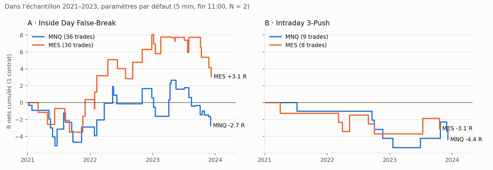

# Deux setups price action Reddit sur MNQ et MES : bilan dans l'échantillon

**Date : 2026-11-20 pour l'IS 2021–2023, 2026-11-21 pour l'OOS 2024-01-03 → 2026-11-19.
L'OOS a été lu une seule fois, à la demande de l'utilisateur, avec les règles figées (voir STRATEGIES.md).**

## Verdict final, hors échantillon : les deux setups sont REJETÉS

Critères fixés avant le calcul :
- PF net ≥ 1,2 sur MNQ **et** sur MES ;
- au moins 100 trades par instrument ;
- espérance (en R) positive au moins 2 années sur 3.

| | Trades | PF brut / net | Espérance nette | Total net (USD) | Années positives (R) 2024 · 2025 · 2026 | Critères |
|---|---|---|---|---|---|---|
| A · MNQ | 49 | 1,60 / 1,53 | +0,25 R · +33 USD | +1 626 | +0,47 · +0,26 · −0,13 | PF ✔, années ✔, **trades ✘** |
| A · MES | 42 | 0,86 / 0,77 | −0,01 R · −12 USD | −505 | +0,34 · −0,05 · −0,45 | **PF ✘, années ✘, trades ✘** |
| B · MNQ | 12 | 1,06 / 1,01 | −0,30 R · +1 USD | +13 | −0,12 · −0,20 · −1,01 | **PF ✘, années ✘, trades ✘** |
| B · MES | 16 | 1,38 / 1,24 | −0,06 R · +12 USD | +195 | −0,69 · +0,13 · +0,45 | PF ✔, années ✔, **trades ✘** |

- **A est rejeté.**
  - Il manque d'abord des trades : 49 et 42, pour un minimum de 100.
  - Sur MES, il perd (PF net 0,77).
  - **Les deux instruments ont échangé leurs rôles par rapport à l'IS** : MNQ passe de 0,69 à 1,53, et MES de 1,71 à 0,77. Un vrai edge sur deux indices aussi corrélés ne s'inverserait pas ainsi. C'est la signature du bruit sur des échantillons de 30 à 50 trades.
- **B est rejeté.** Il donne 12 et 16 trades en près de 3 ans, avec une espérance en R négative sur les deux instruments. Le PF en USD (1,01 et 1,24) repose sur 1 à 3 trades gagnants à stop large.
- **Drawdown au 95ᵉ percentile** (Monte Carlo sur l'ordre des trades OOS, 1 micro) : A · MNQ 1 467 USD, A · MES 1 255, B · MNQ 1 006, B · MES 639.
- **Faisabilité Topstep : non calculée**, puisqu'aucun setup n'est retenu.

L'espérance en R et le total en USD peuvent avoir des signes différents, parce que la taille du stop varie beaucoup d'un trade à l'autre. Le stop médian de A · MNQ est de 349 ticks en OOS, contre 181 en IS. Le critère « années positives » est calculé en R. Calculé en USD, il ne changerait pas le verdict.

Détail : [outputs_oos/](outputs_oos/), dont `by_year_side_oos.csv`. Cette lecture est la seule : le dossier refuse un second passage.

## Verdict IS (2026-11-20, avant la lecture OOS)

| Setup | Verdict | Raison principale |
|---|---|---|
| **A, Inside Day False-Break** | **Rejeté** au regard des critères | Pas assez de trades pour être validé : 10 à 15 par an et par instrument, dans toutes les cellules de la grille. Hors échantillon (2024-01 → 2026-11), on peut en attendre environ 35, pour un minimum exigé de 100. Les résultats IS se contredisent aussi entre MNQ (PF net 0,69) et MES (1,71 sur 30 trades). |
| **B, Intraday 3-Push** | **Rejeté** dès l'échantillon | Aucun edge. Avec les réglages par défaut : 8 à 9 trades en 3 ans. Il y a 17 cellules à au moins 100 trades par instrument, et une seule dépasse un PF net de 1 (MNQ, 1 min, N = 3, fin 10:30 : 1,02). Sur MES, aucune ne dépasse 0,89. |

Les chiffres annoncés sur Reddit (PF ≈ 1,3, Sharpe 4,4) ne se retrouvent dans aucune variante. Au mieux, le PF brut est proche de 1, avant les coûts.

Je n'ai pas cherché à sauver ces setups avec des filtres. Le passage hors échantillon reste à ta disposition (voir « Prochaines étapes »). Il ne peut pas faire valider A, faute d'assez de trades.

## Données et méthode

- **Données :** `MNQ.v.0` et `MES.v.0` en 1 min (Databento, 19,43 USD), sans ajustement. Aucune comparaison entre jours ne se fait à cheval sur un changement de contrat.
- **Règles :** celles de [STRATEGIES.md](STRATEGIES.md), proposées mais pas encore validées.
- **Signaux :** calculés à la clôture de bougies de 5 min. Le parcours du prix est simulé en 1 min. Si le stop et l'objectif sont touchés dans la même minute, c'est le stop qui compte.
- **Coûts, comptés en ticks :** 1 tick à l'entrée, 2 ticks sur les stops, 0 sur les objectifs, 1 tick sur la sortie forcée, plus 2,50 USD de commission aller-retour par micro. Les résultats sont donnés pour 1 micro.
- **Garde-fou :** `run_is.py` charge les données jusqu'au 2024-01-01 exclu et vérifie que rien ne dépasse cette date.
- **Tests :** 10 tests dans [tests/test_price_action.py](../../tests/test_price_action.py). L'un vérifie qu'on peut remplacer tout ce qui suit l'instant t par du bruit, ou tronquer les données à t, sans changer aucun signal antérieur à t. Une fuite injectée volontairement est bien détectée.

## Résultats IS, paramètres par défaut (5 min, fin 11:00, N = 2)

| | A · MNQ | A · MES | B · MNQ | B · MES |
|---|---|---|---|---|
| Trades | 36 | 30 | 9 | 8 |
| Taux de réussite | 36 % | 40 % | 22 % | 25 % |
| Gain moyen / perte moyenne (USD) | +120 / −98 | +107 / −42 | +107 / −77 | +154 / −61 |
| Gain moyen / perte moyenne (R) | +1,40 / −0,91 | +1,74 / −0,99 | +1,51 / −1,06 | +1,91 / −1,15 |
| Espérance nette | −0,08 R · −19 USD | +0,10 R · +18 USD | −0,49 R · −36 USD | −0,39 R · −8 USD |
| Espérance brute | −0,02 R | +0,25 R | −0,43 R | −0,25 R |
| PF brut / net | 0,74 / 0,69 | 2,06 / 1,71 | 0,43 / 0,40 | 0,95 / 0,83 |
| Total net (USD) | −700 | +534 | −327 | −61 |
| Drawdown max (USD) | 843 | 228 | 365 | 201 |
| Drawdown au 95ᵉ percentile, Monte Carlo (USD) | 1 555 | 435 | 540 | 369 |
| Pire journée (USD) | −340 | −94 | −119 | −113 |
| Pire série de pertes | 6 | 4 | 5 | 3 |
| Mois positifs (parmi ceux avec trade) | 35 % | 46 % | 22 % | 29 % |
| Stop médian (ticks) | 181 | 40 | 130 | 35 |
| Coût moyen par trade | 0,06 R | 0,15 R | 0,06 R | 0,14 R |

Le Monte Carlo mélange 10 000 fois l'ordre des trades.

Les résultats sont donnés en R (rapportés au risque prévu de chaque trade) et en USD. Comme la taille du stop varie beaucoup d'un trade à l'autre, l'espérance en R et le PF en USD peuvent avoir des signes différents.

### Par année (espérance nette en R, total net en USD)

| | 2021 | 2022 | 2023 |
|---|---|---|---|
| A · MNQ | −0,22 R · −631 (13 trades) | +0,43 R · +124 (8) | −0,22 R · −193 (15) |
| A · MES | +0,05 R · +208 (7) | +0,77 R · +523 (10) | −0,38 R · −196 (13) |
| B · MNQ | 1 trade | 3 trades, −182 | 5 trades, −26 |
| B · MES | 1 trade | 5 trades, −46 | 2 trades, +15 |

Sur A, le gain de MES vient de 2022. En 2023, l'espérance est négative sur les deux instruments.

### Par sens (A)

| | Long | Short |
|---|---|---|
| A · MNQ | 18 trades, +0,07 R, +128 USD | 18 trades, −0,23 R, −828 USD |
| A · MES | 13 trades, −0,25 R, +81 USD | 17 trades, +0,37 R, +453 USD |

Le sens gagnant est inversé d'un instrument à l'autre, alors que MNQ et MES suivent des indices très corrélés. C'est le comportement attendu d'un échantillon trop petit, pas d'un edge.

Le détail complet, par année et par sens, est dans [by_year_side_is.csv](outputs_is/by_year_side_is.csv).

## Grille exploratoire (IS) : nombre de trades et PF net

**Setup A.** Bougie × fin de fenêtre. Chaque case donne MNQ | MES.

| Bougie | Fin 10:30 | Fin 11:00 | Fin 11:30 |
|---|---|---|---|
| 1 min | 32 / 1,22 · 32 / 0,94 | 39 / 1,07 · 34 / 0,93 | 46 / 1,00 · 37 / 1,45 |
| 3 min | 30 / 1,03 · 29 / 2,02 | 37 / 0,82 · 31 / 1,97 | 43 / 0,82 · 35 / 2,23 |
| 5 min | 29 / 0,87 · 27 / 2,00 | **36 / 0,69 · 30 / 1,71** | 42 / 0,75 · 36 / 2,01 |
| 15 min | 25 / 0,52 · 24 / 1,65 | 32 / 0,49 · 27 / 1,46 | 36 / 0,45 · 32 / 1,67 |

- **Aucune cellule ne dépasse 46 trades en 3 ans.**
- À partir de 3 min, MES est au-dessus de 1 et MNQ en dessous, sauf une cellule à 1,03.
- Aucune cellule n'est bonne sur les deux instruments à la fois avec plus de 35 trades.

**Setup B.** Cellules avec au moins 100 trades IS (MNQ | MES).

| Bougie | N | Fin 10:30 | Fin 11:00 | Fin 11:30 |
|---|---|---|---|---|
| 1 min | 1 | 644 / 0,96 · 612 / 0,72 | 716 / 0,95 · 682 / 0,71 | 732 / 0,95 · 702 / 0,70 |
| 1 min | 2 | 496 / 0,73 · 481 / 0,63 | 632 / 0,73 · 608 / 0,64 | 677 / 0,76 · 657 / 0,64 |
| 1 min | 3 | 352 / 1,02 · 333 / 0,70 | 533 / 0,89 · 527 / 0,70 | 604 / 0,89 · 611 / 0,70 |
| 3 min | 1 | 183 / 0,75 · 174 / 0,74 | 385 / 0,78 · 397 / 0,83 | 497 / 0,74 · 519 / 0,78 |
| 3 min | 2 | — | 148 / 0,82 · 136 / 0,89 | 300 / 0,74 · 287 / 0,71 |
| 3 min | 3 | — | — | 119 / 0,73 · 120 / 0,61 |
| 5 min | 1 | — | 130 / 0,89 · 113 / 0,82 | 265 / 0,74 · 249 / 0,69 |

Sur MES en 1 min, le stop médian ne fait que 20 ticks. Les coûts y mangent 0,24 R par trade, alors que le brut est déjà négatif. La grille complète est dans [grid_is.csv](outputs_is/grid_is.csv).

## Robustesse (±20 % autour des valeurs par défaut, IS)

PF net, MNQ | MES ([robustness_is.csv](outputs_is/robustness_is.csv)).

| Variante | A | B |
|---|---|---|
| Défaut | 0,69 · 1,71 | 0,40 · 0,83 (9 et 8 trades) |
| Bougie 4 / 6 min | 0,79 · 1,28 / 0,60 · 1,36 | 0,92 · 1,22 (37 / 27 trades) / aucun trade |
| Fin 10:42 / 11:18 | 0,84 · 1,67 / 0,71 · 1,94 | 1 / 2 trades · 0,58 · 0,43 |
| Stop minimum 6 / 10 ticks | inchangé (stops médians de 40 à 180 ticks) | inchangé |
| Objectif 1,6 R / 2,4 R | 0,65 · 1,73 / 0,78 · 1,60 | 0,42 · 0,66 / 0,44 · 1,01 |

Sur A, MES reste au-dessus de 1,2 dans toutes les variantes et MNQ reste sous 1. Il n'y a pas d'effondrement brutal, mais on ne peut pas parler de plateau sur 30 trades : l'erreur type de l'espérance est d'environ 0,25 R, contre une espérance de +0,10 R. B n'a pas assez de trades pour qu'on puisse parler de robustesse.

## Faisabilité Topstep

Je ne l'ai pas calculée. Il manque tes paramètres de compte (drawdown maximal suiveur, limite de perte quotidienne, commission), et aucun setup ne passe les critères. Pour mémoire, le drawdown au 95ᵉ percentile du Monte Carlo IS est de 435 USD par micro sur A · MES, et de 1 555 USD sur A · MNQ.

## Prochaines étapes

1. **Fermé.** Le hors-échantillon a été lu le 2026-11-21 (voir le verdict final en tête). Pas de variante ni de filtre de sauvetage sur ces données.
2. Le setup A n'est **pas testable statistiquement** sur un seul instrument : 10 à 15 trades par an. L'élargir à d'autres marchés (M2K, MYM, MGC…) serait une **nouvelle hypothèse**, à écrire avant tout calcul, et elle devrait déclarer que le hors-échantillon MNQ/MES a déjà été lu.
3. Pour toute idée intraday à stop serré sur MES : vérifier d'abord le coût en R. À 20 ticks de stop, il vaut 0,24 R par trade.

## Fichiers

[STRATEGIES.md](STRATEGIES.md) · [research_log.md](research_log.md) · [run_is.py](run_is.py) · [plot_is.py](plot_is.py) · [outputs_is/](outputs_is/) · code [src/price_action/](../../src/price_action/)
